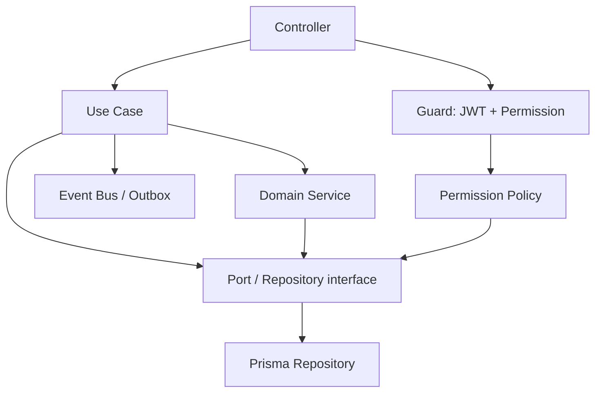
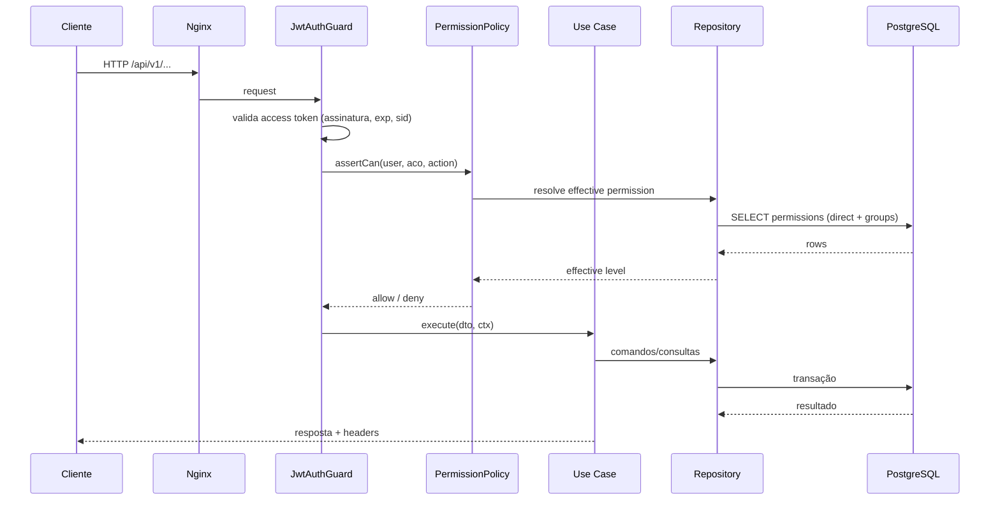

# Backend — NestJS

## 1. Visão geral

Backend modular monolítico em **NestJS 11 + TypeScript + Prisma + PostgreSQL + Redis + BullMQ**. Cada domínio é um módulo independente, com camadas internas e contratos explícitos. Não há comunicação direta entre repositórios de módulos diferentes.



## 2. Árvore do projeto

```text
backend/
├── prisma/
│   ├── schema.prisma
│   ├── migrations/
│   └── seed.ts
├── src/
│   ├── main.ts
│   ├── app.module.ts
│   ├── shared/
│   │   ├── database/          # PrismaService, UnitOfWork, transaction helpers
│   │   ├── decorators/        # @CurrentUser, @RequirePermission, @Public
│   │   ├── guards/            # JwtAuthGuard, PermissionGuard
│   │   ├── interceptors/      # logging, timeout, idempotency, transform
│   │   ├── filters/           # AllExceptionsFilter
│   │   ├── exceptions/        # DomainException hierarchy
│   │   ├── events/            # EventBus, outbox publisher
│   │   ├── logging/           # pino logger, redaction
│   │   └── utils/             # pagination, ids, validation
│   ├── modules/
│   │   ├── authentication/
│   │   ├── users/
│   │   ├── cryptography/
│   │   ├── resource-types/
│   │   ├── resources/
│   │   ├── secrets/
│   │   ├── folders/
│   │   ├── groups/
│   │   ├── permissions/
│   │   ├── sharing/
│   │   ├── audit/
│   │   ├── mfa/
│   │   ├── sessions/
│   │   ├── notifications/
│   │   └── administration/
│   └── infrastructure/
│       ├── queue/             # BullMQ registration
│       ├── cache/             # Redis client
│       ├── storage/           # object storage (exports/backups)
│       ├── email/             # SMTP adapter
│       └── security/          # Argon2, TOTP, WebAuthn, JWT, KMS
└── test/
    ├── unit/
    ├── integration/
    ├── api/
    └── e2e/
```

## 3. Camadas e regra de dependência

| Camada | Pode depender de | Nunca depende de |
|---|---|---|
| `presentation` | `application`, `shared` | `infrastructure`, `domain` de outro módulo |
| `application` | `domain`, `shared`, contratos de outros módulos | `infrastructure` concreto |
| `domain` | nada (exceto `shared` puro) | Prisma, Nest, HTTP |
| `infrastructure` | `domain` (implementa ports), `shared` | `presentation` |

Regras práticas:

- `domain` não importa `@nestjs/*` nem `@prisma/client`.
- `infrastructure` implementa interfaces definidas em `domain/interfaces` ou `application/ports`.
- `presentation` não contém regra de negócio; apenas valida DTO, chama use case e formata resposta.
- Outro módulo só é acessado por:
  1. serviço público exposto no `*.module.ts`, ou
  2. evento de domínio/evento de integração.

## 4. Estrutura interna de um módulo

```text
modules/resources/
├── application/
│   ├── dto/
│   ├── use-cases/
│   │   ├── create-resource.use-case.ts
│   │   ├── get-resource.use-case.ts
│   │   └── list-resources.use-case.ts
│   └── resources.public-service.ts   # contrato público do módulo
├── domain/
│   ├── entities/resource.entity.ts
│   ├── value-objects/resource-id.vo.ts
│   ├── interfaces/resource-repository.interface.ts
│   ├── policies/resource-policy.ts
│   └── events/resource-created.event.ts
├── infrastructure/
│   └── repositories/prisma-resource.repository.ts
├── presentation/
│   └── controllers/resources.controller.ts
└── resources.module.ts
```

**Quando não criar uma camada**: value objects, policies e events só existem quando há regra real. Um CRUD simples pode ter apenas `application` + `infrastructure` + `presentation`, com o Prisma model como representação de persistência.

## 5. Contratos públicos entre módulos

Os contratos abaixo são a única forma de um módulo consumir outro. Eles usam DTOs/entidades de domínio, nunca models do Prisma.

### Permissions (consumido por Resources, Secrets, Folders, Sharing)

```ts
export interface PermissionQueryPort {
  assertCan(userId: string, aco: AcoRef, action: PermissionAction): Promise<void>;
  can(userId: string, aco: AcoRef, action: PermissionAction): Promise<boolean>;
  getEffectivePermission(userId: string, aco: AcoRef): Promise<PermissionLevel>;
  listEffectivePermissions(aco: AcoRef): Promise<EffectivePermission[]>;
}

export type AcoRef =
  | { type: 'RESOURCE'; id: string }
  | { type: 'FOLDER'; id: string };

export type PermissionAction = 'READ' | 'UPDATE' | 'DELETE' | 'SHARE';
export type PermissionLevel = 'READ' | 'UPDATE' | 'OWNER';
```

### Secrets (consumido por Sharing e Resources)

```ts
export interface SecretStorePort {
  createVersion(input: CreateSecretVersionInput): Promise<SecretVersion>;
  getCurrentVersion(resourceId: string): Promise<SecretVersion | null>;
  getRecipientEnvelope(resourceId: string, userId: string): Promise<SecretEnvelope | null>;
  replaceRecipients(resourceId: string, envelopes: SecretEnvelope[]): Promise<void>;
  revokeUser(resourceId: string, userId: string): Promise<void>;
}
```

> O porto **não** possui método `decrypt`. Isso é uma garantia arquitetural, reforçada por teste de contrato.

### Cryptography (consumido por Sharing, Users)

```ts
export interface PublicKeyDirectoryPort {
  getActiveKey(userId: string): Promise<UserPublicKey>;
  getActiveKeys(userIds: string[]): Promise<Map<string, UserPublicKey>>;
  assertKeyIsValid(userId: string, armoredPublicKey: string): Promise<KeyValidationResult>;
  getServerKey(): Promise<ServerKey>;
}
```

### Groups (consumido por Permissions, Sharing, Notifications)

```ts
export interface GroupMembershipPort {
  listActiveMemberIds(groupId: string): Promise<string[]>;
  listActiveManagerIds(groupId: string): Promise<string[]>;
  isManager(userId: string, groupId: string): Promise<boolean>;
  getEffectiveGroupIds(userId: string): Promise<string[]>;
}
```

### Events (todos os módulos)

```ts
export interface DomainEventBus {
  publish<TEvent extends DomainEvent>(event: TEvent): Promise<void>;
  subscribe<TEvent extends DomainEvent>(type: string, handler: (e: TEvent) => Promise<void>): void;
}
```

## 6. Catálogo de eventos

| Evento | Chave | Payload (sem segredos) | Consumidores |
|---|---|---|---|
| `user.registered.v1` | `user.registered.v1` | `userId`, `email`, `source` | Notifications, Audit |
| `user.activated.v1` | `user.activated.v1` | `userId`, `method` | Audit, Notifications |
| `user.suspended.v1` | `user.suspended.v1` | `userId`, `reason` | Sessions (revogar), Sharing (rekey pendente), Audit |
| `session.created.v1` | `session.created.v1` | `sessionId`, `userId`, `deviceId` | Audit, Notifications |
| `session.revoked.v1` | `session.revoked.v1` | `sessionId`, `userId`, `reason` | Audit |
| `mfa.enabled.v1` | `mfa.enabled.v1` | `userId`, `method` | Audit, Notifications |
| `resource.created.v1` | `resource.created.v1` | `resourceId`, `ownerId`, `resourceTypeId` | Audit, Search index |
| `resource.updated.v1` | `resource.updated.v1` | `resourceId`, `changedFields[]` | Audit |
| `resource.deleted.v1` | `resource.deleted.v1` | `resourceId`, `actorId` | Audit, Secrets (purge), Sharing |
| `secret.version.created.v1` | `secret.version.created.v1` | `resourceId`, `version`, `formatVersion` | Audit, Notifications |
| `secret.accessed.v1` | `secret.accessed.v1` | `resourceId`, `userId`, `version` | Audit |
| `permission.granted.v1` | `permission.granted.v1` | `aco`, `aro`, `level` | Audit |
| `permission.revoked.v1` | `permission.revoked.v1` | `aco`, `aro`, `level` | Audit, Sharing |
| `group.member.added.v1` | `group.member.added.v1` | `groupId`, `userId`, `rekeyRequired: true` | Sharing (criar operação), Notifications, Audit |
| `group.member.removed.v1` | `group.member.removed.v1` | `groupId`, `userId`, `resourceIds[]` | Sharing (revogar), Audit |
| `sharing.completed.v1` | `sharing.completed.v1` | `operationId`, `resourceId` | Audit, Notifications |
| `sharing.failed.v1` | `sharing.failed.v1` | `operationId`, `reason` | Audit, Notifications |

**Regra de ouro**: nenhum evento pode carregar `ciphertext`, `passphrase`, `privateKey`, `password` ou `totpSecret`.

## 7. Fluxo de uma requisição



## 8. Validação e DTOs

- `class-validator` + `class-transformer` com `whitelist: true`, `forbidNonWhitelisted: true`.
- DTOs de entrada nunca expõem campos de persistência.
- DTOs de saída usam `presenters` para omitir campos sensíveis (`passwordHash`, `totpSecret`, `ciphertext` quando não autorizado).
- Validação de envelope (tamanho, armor, fingerprint) é responsabilidade do módulo `Secrets`, não do controller.
- Payload máximo configurável (default 256 KiB por envelope; total por recurso 1 MiB).

## 9. Erros e respostas

Hierarquia de exceções:

```text
DomainException
├── NotFoundException        → 404
├── ConflictException        → 409
├── ValidationException      → 422
├── ForbiddenException       → 403
├── UnauthorizedException    → 401
├── PreconditionException    → 412 (ex.: envelope inválido, idêntico)
├── RateLimitException       → 429
└── InternalException        → 500 (nunca ecoa detalhe interno)
```

Formato de erro (Problem Details):

```json
{
  "type": "https://api.securevault.local/errors/permission-denied",
  "title": "Permission denied",
  "status": 403,
  "code": "PERMISSION_DENIED",
  "requestId": "01J...",
  "details": [{ "field": "resourceId", "issue": "forbidden" }]
}
```

- `requestId` em toda resposta e log.
- Nunca incluir stack trace, SQL, fingerprint de chave ou ciphertext.
- `AllExceptionsFilter` é o único ponto de tradução para HTTP.

## 10. Convenções de API

- Base: `/api/v1`.
- REST + OpenAPI 3.1 (Swagger em `/api/docs`, protegido em produção).
- Versionamento por URL; versão `v1` congelada após 1.0.
- Paginação: `?page=1&pageSize=50&cursor=` — cursor obrigatório para listas grandes.
- Ordenação allowlist (`sort=name:asc`).
- Filtros allowlist (`type`, `folderId`, `sharedWithMe`, `q`).
- Idempotência: operações `POST/PATCH` sensíveis aceitam `Idempotency-Key`; armazenado em `sharing_operations`/tabela de idempotência com TTL de 24h.
- Concurrency: `If-Match`/`version` em recursos e segredos.
- Rate limit por usuário/IP em autenticação e operações de escrita.
- CORS restrito à origem da SPA em produção; same-origin recomendado via Nginx.

### Endpoints por módulo (resumo)

| Módulo | Endpoints principais |
|---|---|
| Authentication | `POST /auth/login`, `POST /auth/mfa/verify`, `POST /auth/refresh`, `POST /auth/logout`, `POST /auth/recover/request`, `POST /auth/recover/confirm` |
| Sessions | `GET /sessions`, `DELETE /sessions/:id`, `DELETE /sessions` |
| MFA | `POST /mfa/totp/setup`, `POST /mfa/totp/verify`, `POST /mfa/webauthn/register/options`, `POST /mfa/webauthn/register/verify`, `DELETE /mfa/:id` |
| Users | `GET /users`, `POST /users`, `GET /users/:id`, `PATCH /users/:id`, `POST /users/:id/keys` |
| Resources | `GET /resources`, `POST /resources`, `GET /resources/:id`, `PATCH /resources/:id`, `DELETE /resources/:id`, `GET /resources/search` |
| Secrets | `GET /resources/:id/secret`, `PUT /resources/:id/secret`, `GET /resources/:id/secret/versions` |
| Folders | `GET /folders`, `POST /folders`, `PATCH /folders/:id`, `DELETE /folders/:id`, `POST /folders/:id/move` |
| Groups | `GET /groups`, `POST /groups`, `POST /groups/:id/members`, `DELETE /groups/:id/members/:userId` |
| Permissions | `GET /resources/:id/permissions`, `PUT /resources/:id/permissions`, `GET /folders/:id/permissions`, `PUT /folders/:id/permissions` |
| Sharing | `POST /sharing`, `POST /sharing/revoke`, `POST /sharing/rekey/:operationId/complete`, `GET /sharing/operations/:id` |
| Audit | `GET /audit`, `GET /audit/export` |
| Administration | `GET/POST /admin/settings`, `POST /admin/users/:id/suspend`, `POST /admin/keys/rotate` |

## 11. Autenticação e autorização no controller

- `@UseGuards(JwtAuthGuard, PermissionGuard)` no controller ou rota.
- `@RequirePermission({ aco: 'RESOURCE', action: 'READ', fromParam: 'id' })`.
- O `PermissionGuard` resolve o ACO a partir do parâmetro e chama `PermissionQueryPort.assertCan`.
- Controllers **não** chamam `permissionService` diretamente; usam o decorator/guard.
- Use cases que operam em lote (sharing, move) recebem o contexto do usuário e chamam a policy explicitamente, com testes dedicados.
- `@Public()` apenas em auth, health, server key e webhooks.

## 12. Processamento assíncrono (BullMQ)

| Fila | Tarefas | Por que não é síncrono |
|---|---|---|
| `notifications` | e-mail de convite, alerta de novo dispositivo, notificação in-app | I/O externo |
| `audit-projection` | projeções e exportações | Isolar banco de auditoria |
| `retention` | expurgo de versões antigas, soft-deleted, tokens | Execução agendada |
| `rekey-followup` | verificar operações PENDING de rekey e notificar gestores | Timeout/alerta |
| `search-index` | atualizar índice textual | Carga |
| `webhooks` | integrações externas | I/O externo |

**Limite explícito**: nenhuma fila executa cifragem/decifragem de segredos. Re-criptografia é sempre iniciada por um cliente autorizado, que envia os envelopes prontos. O backend apenas valida e persiste.

## 13. Configuração e DI

- `@nestjs/config` com validação de env (zod) no boot: falha rápido se `DATABASE_URL`, `JWT_PRIVATE_KEY`, `JWT_PUBLIC_KEY`, `REDIS_URL`, `SERVER_KEY_PATH` não existirem.
- `PrismaService` implementa `OnModuleInit`/`OnModuleDestroy`.
- `ConfigService` tipado por módulo de config.
- Segredos nunca em log; `JWT_PRIVATE_KEY` e `TOTP_ENC_KEY` vêm de secret manager/arquivo montado.

## 14. Logging e observabilidade

- `pino` com JSON estruturado: `timestamp`, `level`, `requestId`, `userId`, `method`, `path`, `statusCode`, `durationMs`, `event`.
- Redaction: chaves `password`, `passphrase`, `privateKey`, `secret`, `ciphertext`, `authorization`, `cookie`, `totpSecret`.
- Métricas: contadores de login, falhas, latência por endpoint, filas, permissões negadas.
- Health checks: `/health/live`, `/health/ready` (Postgres, Redis, fila).
- Tracing opcional: OpenTelemetry propagando `traceparent`.

## 15. Testes

| Tipo | Escopo | Ferramenta |
|---|---|---|
| Unit | Regras de domínio, policies, use cases | Jest |
| Integration | Repositórios Prisma, transações, constraints | Jest + Testcontainers/Postgres |
| API | Contratos HTTP, auth, paginação, erros | Jest + Supertest |
| Authorization | Matriz READ/UPDATE/OWNER | Jest + fixtures |
| Concurrency | Criação/atualização de segredo, rekey | Jest + concorrência controlada |
| Migration | Up/down, constraints, índices | Jest + `prisma migrate diff` |
| E2E | Fluxos críticos | Playwright (Fase 5/6) |

Cobertura mínima: 80% em `domain` e `application` dos módulos críticos (auth, permissions, sharing, secrets, groups). Regras de autorização exigem teste explícito por nível.

## 16. Matriz de dependências entre módulos

| De ↓ / Para → | Auth | Users | Crypto | Res | Sec | Fold | Groups | Perm | Share | Audit | MFA | Sess | Notif | Admin |
|---|---|---|---|---|---|---|---|---|---|---|---|---|---|---|
| Auth | — | ✔ | | | | | | | | ✔ | ✔ | ✔ | ✔ | |
| Users | | — | ✔ | | | | | | | ✔ | | | ✔ | |
| Crypto | | ✔ | — | | | | | | ✔ | | ✔ | | |
| Resources | | | | — | ✔ | | | ✔ | | ✔ | | | | |
| Secrets | | | | ✔ | — | | | ✔ | | ✔ | | | | |
| Folders | | | | ✔ | | — | | ✔ | | ✔ | | | | |
| Groups | | ✔ | | | | | — | ✔ | ✔ | ✔ | | | ✔ | |
| Permissions | | ✔ | | ✔ | ✔ | ✔ | ✔ | — | ✔ | ✔ | | | | |
| Sharing | | ✔ | ✔ | ✔ | ✔ | ✔ | ✔ | ✔ | — | ✔ | | | ✔ | |
| Audit | | | | | | | | | | — | | | | |
| MFA | | ✔ | | | | | | | | ✔ | — | | ✔ | |
| Sessions | | ✔ | | | | | | | | ✔ | | — | ✔ | |
| Notifications | | ✔ | | | | | | | | | | | — | |
| Administration | ✔ | ✔ | ✔ | | | | ✔ | ✔ | | ✔ | | ✔ | | — |

`✔` = dependência permitida via **serviço público** ou **evento**. A seta é sempre de módulo consumidor para provedor; nunca o inverso.

## 17. Swagger/OpenAPI

- Decorators `@ApiTags`, `@ApiOperation`, `@ApiResponse` em controllers e DTOs.
- Esquemas de erro e paginação reutilizáveis.
- Geração de cliente TypeScript no frontend via `openapi-typescript` (Fase 3).
- Swagger desabilitado em produção atrás de feature flag.

## 18. Critérios de prontidão de um módulo

1. Domínio modelado com invariantes testadas.
2. Repositório com testes de integração.
3. Casos de uso com testes de autorização.
4. Eventos publicados e consumidos (quando aplicável).
5. Controller com DTO, validação, Swagger.
6. Nenhum acesso cruzado a repositório de outro módulo.
7. Nenhum segredo em log.
8. Documentação em `docs/domains/<modulo>.md` atualizada.