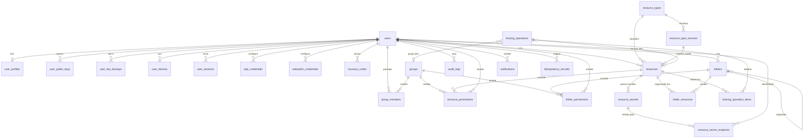

# Banco de Dados — PostgreSQL

## 1. Convenções

| Item | Convenção |
|---|---|
| SGBD | PostgreSQL 17 (compatível com Neon) |
| ORM | Prisma |
| PK | `uuid` (UUIDv7 gerado na aplicação para ordenação temporal) |
| Nomenclatura | `snake_case` no banco; `camelCase` no Prisma |
| Timestamps | `timestamptz` (UTC), `created_at`, `updated_at` |
| Soft delete | `deleted_at` em usuários, grupos, recursos, pastas, chaves, sessões |
| Hard delete | envelopes de segredo, códigos de recuperação usados, tokens expirados |
| Enums | PostgreSQL enums para domínios estáveis |
| JSONB | apenas metadados, schemas de tipo e settings; nunca para relacionamentos |
| Integridade | FKs obrigatórias; `ON DELETE RESTRICT` por padrão |
| Migrations | versionadas, revisadas, `prisma migrate deploy` |
| Multi-tenant | não (single organization) |

## 2. Diagrama entidade-relacionamento



> O diagrama omite `server_public_keys`, `organization_settings`, `outbox_events` e `resource_type_versions.schema` por legibilidade; eles estão na seção 4.

## 3. Enumerações

| Enum | Valores |
|---|---|
| `user_role` | `USER`, `ADMIN` |
| `user_status` | `PENDING`, `ACTIVE`, `SUSPENDED`, `DELETED` |
| `permission_level` | `READ`, `UPDATE`, `OWNER` |
| `permission_action` | `READ`, `UPDATE`, `DELETE`, `SHARE` |
| `aro_type` | `USER`, `GROUP` |
| `aco_type` | `RESOURCE`, `FOLDER` |
| `resource_status` | `ACTIVE`, `ARCHIVED`, `TRASHED` |
| `group_member_role` | `MEMBER`, `MANAGER` |
| `mfa_method` | `TOTP`, `WEBAUTHN` |
| `sharing_operation_type` | `SHARE`, `UNSHARE`, `UPDATE_PERMISSION`, `REKEY`, `GROUP_REKEY` |
| `sharing_operation_status` | `PENDING`, `IN_PROGRESS`, `COMPLETED`, `FAILED`, `EXPIRED` |
| `audit_actor_type` | `USER`, `SYSTEM`, `ADMIN` |
| `notification_status` | `PENDING`, `SENT`, `READ`, `FAILED` |

## 4. Tabelas

### 4.1 Identidade e acesso

#### `users`

| Coluna | Tipo | Restrições |
|---|---|---|
| `id` | uuid | PK |
| `email` | text | NOT NULL, UNIQUE (lowercase normalizado) |
| `password_hash` | text | NULL (Argon2id) |
| `role` | `user_role` | default `USER` |
| `status` | `user_status` | default `PENDING` |
| `failed_login_count` | int | default 0 |
| `locked_until` | timestamptz | NULL |
| `last_login_at` | timestamptz | NULL |
| `created_at` | timestamptz | NOT NULL, default now() |
| `updated_at` | timestamptz | NOT NULL |
| `deleted_at` | timestamptz | NULL |

Índices: `email` (unique), `status`, `created_at`.

#### `user_profiles`

| Coluna | Tipo | Restrições |
|---|---|---|
| `user_id` | uuid | PK, FK → users(id), `ON DELETE CASCADE` |
| `display_name` | text | NOT NULL |
| `avatar_url` | text | NULL |
| `locale` | text | default `pt-BR` |
| `timezone` | text | default `UTC` |
| `preferences` | jsonb | default `{}`, não sensível |
| `created_at`, `updated_at` | timestamptz | NOT NULL |

#### `user_public_keys`

| Coluna | Tipo | Restrições |
|---|---|---|
| `id` | uuid | PK |
| `user_id` | uuid | FK → users, CASCADE |
| `fingerprint` | text | NOT NULL, UNIQUE |
| `key_id` | text | NOT NULL |
| `armored_public_key` | text | NOT NULL |
| `algorithm` | text | NOT NULL (`ed25519`, `rsa`) |
| `bits` | int | NULL |
| `key_type` | text | NOT NULL (`ecc`, `rsa`) |
| `uid` | text | NOT NULL (e-mail/nome) |
| `expires_at` | timestamptz | NULL |
| `is_primary` | bool | default true |
| `revoked_at` | timestamptz | NULL |
| `created_at` | timestamptz | NOT NULL |

Índices: `fingerprint` unique, `(user_id, is_primary)`, `revoked_at` partial.

#### `user_key_backups` (escrow opcional)

| Coluna | Tipo | Restrições |
|---|---|---|
| `id` | uuid | PK |
| `user_id` | uuid | FK → users, CASCADE |
| `key_fingerprint` | text | NOT NULL |
| `ciphertext` | text | NOT NULL (blob opaco cifrado no cliente) |
| `kdf` | jsonb | NOT NULL (`{alg, iterations, salt}`) |
| `format_version` | text | NOT NULL |
| `consent_at` | timestamptz | NOT NULL |
| `created_at` | timestamptz | NOT NULL |

> O servidor nunca recebe a passphrase nem a chave em claro. Esta tabela é opt-in.

#### `user_devices`

| Coluna | Tipo | Restrições |
|---|---|---|
| `id` | uuid | PK |
| `user_id` | uuid | FK → users, CASCADE |
| `name` | text | NOT NULL |
| `user_agent` | text | NULL |
| `device_fingerprint` | text | NULL |
| `is_trusted` | bool | default false |
| `last_seen_at` | timestamptz | NOT NULL |
| `revoked_at` | timestamptz | NULL |
| `created_at` | timestamptz | NOT NULL |

Índice: `(user_id, revoked_at)`.

#### `user_sessions`

| Coluna | Tipo | Restrições |
|---|---|---|
| `id` | uuid | PK |
| `user_id` | uuid | FK → users, CASCADE |
| `device_id` | uuid | FK → user_devices, RESTRICT |
| `refresh_token_hash` | text | NOT NULL, UNIQUE (SHA-256) |
| `ip` | inet | NULL |
| `user_agent` | text | NULL |
| `mfa_amr` | jsonb | NOT NULL (métodos satisfeitos) |
| `issued_at` | timestamptz | NOT NULL |
| `expires_at` | timestamptz | NOT NULL |
| `revoked_at` | timestamptz | NULL |
| `replaced_by` | uuid | NULL, FK → user_sessions(id) |
| `created_at` | timestamptz | NOT NULL |

Índices: `refresh_token_hash` unique, `(user_id, revoked_at)`, `expires_at`.

> A lista inicial previa `refresh_tokens`; foi **consolidada** em `user_sessions` porque o refresh token é o identificador da sessão. Não há tabela separada.

#### `totp_credentials`

| Coluna | Tipo | Restrições |
|---|---|---|
| `id` | uuid | PK |
| `user_id` | uuid | FK → users, CASCADE |
| `secret_encrypted` | text | NOT NULL (KMS envelope) |
| `last_used_step` | bigint | NULL (anti-replay) |
| `confirmed_at` | timestamptz | NULL |
| `disabled_at` | timestamptz | NULL |
| `created_at` | timestamptz | NOT NULL |

Índice único parcial: `(user_id)` where `disabled_at is null`.

#### `webauthn_credentials`

| Coluna | Tipo | Restrições |
|---|---|---|
| `id` | uuid | PK |
| `user_id` | uuid | FK → users, CASCADE |
| `credential_id` | text | NOT NULL, UNIQUE |
| `public_key` | text | NOT NULL |
| `counter` | bigint | NOT NULL default 0 |
| `transports` | jsonb | NULL |
| `device_name` | text | NOT NULL |
| `confirmed_at` | timestamptz | NULL |
| `disabled_at` | timestamptz | NULL |
| `created_at` | timestamptz | NOT NULL |

#### `recovery_codes`

| Coluna | Tipo | Restrições |
|---|---|---|
| `id` | uuid | PK |
| `user_id` | uuid | FK → users, CASCADE |
| `code_hash` | text | NOT NULL, UNIQUE |
| `used_at` | timestamptz | NULL |
| `created_at` | timestamptz | NOT NULL |

### 4.2 Grupos

#### `groups`

| Coluna | Tipo | Restrições |
|---|---|---|
| `id` | uuid | PK |
| `name` | text | NOT NULL |
| `description` | text | NULL |
| `created_by` | uuid | FK → users, RESTRICT |
| `updated_by` | uuid | FK → users, RESTRICT |
| `created_at`, `updated_at` | timestamptz | NOT NULL |
| `deleted_at` | timestamptz | NULL |

Índice: `(name)` onde `deleted_at is null`.

#### `group_members`

| Coluna | Tipo | Restrições |
|---|---|---|
| `id` | uuid | PK |
| `group_id` | uuid | FK → groups, CASCADE |
| `user_id` | uuid | FK → users, CASCADE |
| `role` | `group_member_role` | default `MEMBER` |
| `added_by` | uuid | FK → users, RESTRICT |
| `added_at` | timestamptz | NOT NULL |
| `removed_at` | timestamptz | NULL |

Índices: único parcial `(group_id, user_id)` onde `removed_at is null`; `(user_id)` onde `removed_at is null`.

### 4.3 Tipos de recurso

#### `resource_types`

| Coluna | Tipo | Restrições |
|---|---|---|
| `id` | uuid | PK |
| `slug` | text | NOT NULL, UNIQUE (`login-password`, `database`, `server`, `wifi`, `api-key`, `token`, `custom`) |
| `name` | text | NOT NULL |
| `description` | text | NULL |
| `current_version` | int | NOT NULL default 1 |
| `is_active` | bool | default true |
| `created_at`, `updated_at` | timestamptz | NOT NULL |

#### `resource_type_versions`

| Coluna | Tipo | Restrições |
|---|---|---|
| `id` | uuid | PK |
| `resource_type_id` | uuid | FK → resource_types, CASCADE |
| `version` | int | NOT NULL |
| `schema` | jsonb | NOT NULL (JSON Schema do conteúdo em claro) |
| `is_active` | bool | default true |
| `created_at` | timestamptz | NOT NULL |

Unique: `(resource_type_id, version)`.

### 4.4 Recursos

#### `resources`

| Coluna | Tipo | Restrições |
|---|---|---|
| `id` | uuid | PK |
| `resource_type_id` | uuid | FK → resource_types, RESTRICT |
| `resource_type_version` | int | NOT NULL |
| `name` | text | NOT NULL |
| `username` | text | NULL |
| `uri` | text | NULL |
| `description` | text | NULL |
| `metadata` | jsonb | default `{}`, não sensível |
| `status` | `resource_status` | default `ACTIVE` |
| `expired_at` | timestamptz | NULL |
| `created_by` | uuid | FK → users, RESTRICT |
| `updated_by` | uuid | FK → users, RESTRICT |
| `created_at`, `updated_at` | timestamptz | NOT NULL |
| `deleted_at` | timestamptz | NULL |
| `search_tsv` | tsvector | generated (name, username, uri, description) |

Índices: `(created_by)`, `(resource_type_id)`, `(status)`, GIN `(search_tsv)`, GIN `(metadata)` quando justificado, `(deleted_at)`.

> `name`, `username`, `uri` e `description` são **metadados em claro** na v1. A v2 poderá cifrá-los; nesse caso `search_tsv` será substituído por índice opcional baseado em tokens.

### 4.5 Segredos

#### `resource_secrets`

| Coluna | Tipo | Restrições |
|---|---|---|
| `id` | uuid | PK |
| `resource_id` | uuid | FK → resources, CASCADE |
| `version` | int | NOT NULL |
| `is_current` | bool | default false |
| `format_version` | text | NOT NULL (`sv1`) |
| `algorithm` | text | NOT NULL |
| `byte_size` | int | NOT NULL |
| `checksum` | text | NOT NULL (SHA-256 do armored message) |
| `created_by` | uuid | FK → users, RESTRICT |
| `created_at` | timestamptz | NOT NULL |
| `deleted_at` | timestamptz | NULL |

Constraints: `(resource_id, version)` unique; índice único parcial `(resource_id)` onde `is_current and deleted_at is null`.

#### `resource_secret_recipients`

| Coluna | Tipo | Restrições |
|---|---|---|
| `id` | uuid | PK |
| `resource_secret_id` | uuid | FK → resource_secrets, CASCADE |
| `user_id` | uuid | FK → users, RESTRICT |
| `key_fingerprint` | text | NOT NULL |
| `armored_message` | text | NOT NULL |
| `signature` | text | NULL |
| `algorithm` | text | NOT NULL |
| `format_version` | text | NOT NULL |
| `checksum` | text | NOT NULL |
| `created_at` | timestamptz | NOT NULL |

Unique: `(resource_secret_id, user_id)`. Índice: `(user_id)`, `(key_fingerprint)`.

> Um envelope por usuário por versão. Para grupos, a permissão fica em `resource_permissions` (ARO=GROUP), mas os envelopes são materializados por membro ativo.

### 4.6 Pastas

#### `folders`

| Coluna | Tipo | Restrições |
|---|---|---|
| `id` | uuid | PK |
| `parent_id` | uuid | NULL, FK → folders(id), RESTRICT |
| `name` | text | NOT NULL |
| `description` | text | NULL |
| `created_by` | uuid | FK → users, RESTRICT |
| `updated_by` | uuid | FK → users, RESTRICT |
| `created_at`, `updated_at` | timestamptz | NOT NULL |
| `deleted_at` | timestamptz | NULL |

Índices: `(parent_id)`, `(created_by)`.

#### `folder_resources`

| Coluna | Tipo | Restrições |
|---|---|---|
| `id` | uuid | PK |
| `folder_id` | uuid | FK → folders, CASCADE |
| `resource_id` | uuid | FK → resources, CASCADE |
| `added_by` | uuid | FK → users, RESTRICT |
| `added_at` | timestamptz | NOT NULL |
| `removed_at` | timestamptz | NULL |

Constraints: único parcial `(folder_id, resource_id)` onde `removed_at is null`; único parcial `(resource_id)` onde `removed_at is null` (um recurso por pasta).

### 4.7 Permissões

#### `resource_permissions`

| Coluna | Tipo | Restrições |
|---|---|---|
| `id` | uuid | PK |
| `resource_id` | uuid | FK → resources, CASCADE |
| `aro_type` | `aro_type` | NOT NULL |
| `aro_id` | uuid | NOT NULL (sem FK por polimorfismo; validado na aplicação) |
| `level` | `permission_level` | NOT NULL |
| `created_by` | uuid | FK → users, RESTRICT |
| `created_at`, `updated_at` | timestamptz | NOT NULL |

Unique: `(resource_id, aro_type, aro_id)`. Índices: `(aro_type, aro_id)`, `(resource_id, level)`.

#### `folder_permissions`

| Coluna | Tipo | Restrições |
|---|---|---|
| `id` | uuid | PK |
| `folder_id` | uuid | FK → folders, CASCADE |
| `aro_type` | `aro_type` | NOT NULL |
| `aro_id` | uuid | NOT NULL |
| `level` | `permission_level` | NOT NULL |
| `created_by` | uuid | FK → users, RESTRICT |
| `created_at`, `updated_at` | timestamptz | NOT NULL |

Unique: `(folder_id, aro_type, aro_id)`. Índices: `(aro_type, aro_id)`, `(folder_id, level)`.

> **Decisão de modelo**: as tabelas `user_permissions`, `group_permissions` e `resource_permissions`/`folder_permissions` da lista inicial foram consolidadas em duas tabelas com ARO polimórfico. Isso evita duplicação de regras e divergência de autorização. O custo é a validação de `aro_id` na aplicação (usuário ativo ou grupo ativo).

### 4.8 Compartilhamento

#### `sharing_operations`

| Coluna | Tipo | Restrições |
|---|---|---|
| `id` | uuid | PK |
| `operation` | `sharing_operation_type` | NOT NULL |
| `actor_id` | uuid | FK → users, RESTRICT |
| `resource_id` | uuid | NULL, FK → resources, CASCADE |
| `group_id` | uuid | NULL, FK → groups, CASCADE |
| `status` | `sharing_operation_status` | NOT NULL default `PENDING` |
| `idempotency_key` | text | NOT NULL, UNIQUE |
| `payload` | jsonb | NOT NULL (destinatários, permissões; sem ciphertext) |
| `error_code` | text | NULL |
| `error_message` | text | NULL |
| `expires_at` | timestamptz | NOT NULL |
| `started_at`, `completed_at` | timestamptz | NULL |
| `created_at` | timestamptz | NOT NULL |

Índices: `(status, expires_at)`, `(actor_id)`, `(resource_id)`, `(group_id)`.

#### `sharing_operation_items`

| Coluna | Tipo | Restrições |
|---|---|---|
| `id` | uuid | PK |
| `operation_id` | uuid | FK → sharing_operations, CASCADE |
| `resource_id` | uuid | FK → resources, CASCADE |
| `status` | `sharing_operation_status` | NOT NULL |
| `envelope_count` | int | NOT NULL default 0 |
| `error_code` | text | NULL |
| `completed_at` | timestamptz | NULL |

Unique: `(operation_id, resource_id)`.

### 4.9 Auditoria

#### `audit_logs`

| Coluna | Tipo | Restrições |
|---|---|---|
| `id` | uuid | PK |
| `occurred_at` | timestamptz | NOT NULL, default now() |
| `actor_id` | uuid | NULL, FK → users, RESTRICT |
| `actor_type` | `audit_actor_type` | NOT NULL |
| `action` | text | NOT NULL (ex.: `resource.secret.accessed`) |
| `target_type` | text | NOT NULL |
| `target_id` | uuid | NULL |
| `metadata` | jsonb | NOT NULL default `{}` (sem segredos) |
| `ip` | inet | NULL |
| `user_agent` | text | NULL |
| `request_id` | text | NULL |
| `prev_hash` | text | NULL (hash chain, Fase 5) |
| `entry_hash` | text | NULL (hash chain, Fase 5) |

Índices: `(occurred_at desc)`, `(actor_id, occurred_at desc)`, `(target_type, target_id, occurred_at desc)`, `(action, occurred_at desc)`. Sem `UPDATE`/`DELETE` na aplicação.

### 4.10 Notificações e administração

#### `notifications`

| Coluna | Tipo | Restrições |
|---|---|---|
| `id` | uuid | PK |
| `user_id` | uuid | FK → users, CASCADE |
| `type` | text | NOT NULL |
| `title` | text | NOT NULL |
| `body` | text | NULL (sem segredos) |
| `resource_id` | uuid | NULL, FK → resources, SET NULL |
| `status` | `notification_status` | default `PENDING` |
| `read_at` | timestamptz | NULL |
| `created_at` | timestamptz | NOT NULL |

Índice: `(user_id, read_at, created_at desc)`.

#### `organization_settings`

| Coluna | Tipo | Restrições |
|---|---|---|
| `id` | int | PK, default 1 (singleton) |
| `settings` | jsonb | NOT NULL (política de senha, MFA, retenção) |
| `updated_by` | uuid | FK → users, RESTRICT |
| `updated_at` | timestamptz | NOT NULL |

#### `server_public_keys`

| Coluna | Tipo | Restrições |
|---|---|---|
| `id` | uuid | PK |
| `kid` | text | NOT NULL, UNIQUE |
| `fingerprint` | text | NOT NULL, UNIQUE |
| `armored_public_key` | text | NOT NULL |
| `algorithm` | text | NOT NULL |
| `is_active` | bool | default true |
| `created_at` | timestamptz | NOT NULL |
| `revoked_at` | timestamptz | NULL |

#### `outbox_events`

| Coluna | Tipo | Restrições |
|---|---|---|
| `id` | uuid | PK |
| `event_type` | text | NOT NULL |
| `aggregate_type` | text | NOT NULL |
| `aggregate_id` | uuid | NOT NULL |
| `payload` | jsonb | NOT NULL (sem segredos) |
| `occurred_at` | timestamptz | NOT NULL |
| `available_at` | timestamptz | NOT NULL |
| `processed_at` | timestamptz | NULL |
| `attempts` | int | NOT NULL default 0 |

Índice: `(available_at)` onde `processed_at is null`.

#### `idempotency_records`

| Coluna | Tipo | Restrições |
|---|---|---|
| `key` | text | PK |
| `user_id` | uuid | FK → users, CASCADE |
| `endpoint` | text | NOT NULL |
| `request_hash` | text | NOT NULL |
| `response_status` | int | NOT NULL |
| `response_body` | jsonb | NULL |
| `created_at` | timestamptz | NOT NULL |
| `expires_at` | timestamptz | NOT NULL |

## 5. Índices estratégicos

| Tabela | Índice | Motivo |
|---|---|---|
| `resources` | GIN `search_tsv` | busca textual |
| `resources` | `(created_by, created_at desc)` | "meus recursos" |
| `resources` | `(resource_type_id, status)` | filtro por tipo |
| `resource_secrets` | único parcial `(resource_id)` | versão corrente |
| `resource_secret_recipients` | `(user_id)` | listar segredos do usuário |
| `resource_permissions` | `(aro_type, aro_id)` | "o que este usuário/grupo acessa" |
| `resource_permissions` | `(resource_id)` | "quem acessa este recurso" |
| `folder_resources` | `(resource_id)` | pasta do recurso |
| `group_members` | `(user_id)` | grupos do usuário |
| `user_sessions` | `(user_id, revoked_at)` | sessões ativas |
| `audit_logs` | `(target_type, target_id, occurred_at desc)` | histórico do recurso |

## 6. JSONB: onde usar e onde não usar

**Usar**:

- `resource_type_versions.schema`: schema dinâmico versionado.
- `resources.metadata`: metadados não sensíveis e flexíveis.
- `organization_settings.settings`: configuração.
- `sharing_operations.payload`: lista de destinatários/alterações.
- `outbox_events.payload`, `notifications.body`, `audit_logs.metadata`.

**Não usar**:

- Para relacionamentos (permissões, membros, envelopes).
- Para campos que precisam de constraint, índice ou integridade.
- Para segredos ou material criptográfico (usar colunas `text` dedicadas).
- Para substituir tabelas de permissão.

## 7. Soft delete e retenção

| Entidade | Soft delete | Expurgo |
|---|---|---|
| Usuário | `deleted_at` | após 90 dias, anonimizar; segredos revogados |
| Grupo | `deleted_at` | após 90 dias |
| Recurso | `deleted_at` | após 30 dias na lixeira |
| Pasta | `deleted_at` | após 30 dias |
| Segredo (versão antiga) | `deleted_at` | após 30 dias (configurável) |
| Envelope revogado | hard delete | imediato |
| Sessão | `revoked_at` | após 90 dias |
| Token de recuperação | hard delete | após uso/expiração |
| Audit log | nunca | retenção 365 dias (configurável) |

## 8. Migrations e integridade

- Prisma Migrate com SQL revisado.
- Toda migration com `up` idempotente e `down` testado quando destrutivo.
- Constraints nomeadas (`fk_`, `ck_`, `uq_`, `ix_`).
- Checks adicionais via SQL:
  - `resource_secrets`: `version > 0`, `byte_size > 0`.
  - `sharing_operations`: `expires_at > created_at`, `resource_id IS NOT NULL OR group_id IS NOT NULL`.
  - `user_sessions`: `expires_at > issued_at`.
- Índices parciais criados via SQL (Prisma não os expressa).
- `search_tsv` como generated column via SQL.
- `pgcrypto` para `gen_random_uuid()` (fallback), `pg_trgm` opcional.

## 9. Isolamento e concorrência

- Toda query de recurso/pasta/segredo passa por autorização antes da leitura.
- Escrita de permissão e envelope na mesma transação (`Prisma.$transaction`).
- `SELECT ... FOR UPDATE` em operações de permissão e versão corrente.
- `version`/`If-Match` em recursos e segredos.
- Sem `queryRaw` com interpolação.

## 10. Backup e restore

- Neon PITR 7–30 dias.
- Dump lógico diário criptografado (object storage) — retenção 30 dias.
- Restore trimestral documentado com checksum e smoke test.
- Backups de chaves privadas? Nunca. Apenas `user_key_backups` (blob cifrado pelo cliente) entra no dump, o que é aceitável por ser opaco.

## 11. Ajustes propostos na lista inicial

| Lista inicial | Decisão | Justificativa |
|---|---|---|
| `user_profiles` | mantida | separação de identidade e perfil |
| `user_public_keys` | mantida | histórico e rotação |
| `refresh_tokens` | consolidada em `user_sessions` | refresh token é a sessão; evita duplicidade |
| `mfa_methods` | desdobrada em `totp_credentials`, `webauthn_credentials`, `recovery_codes` | estruturas diferentes e invariantes próprias |
| `resource_secret_recipients` | mantida | envelope por destinatário |
| `user_permissions` / `group_permissions` | consolidadas em `resource_permissions` / `folder_permissions` com ARO polimórfico | evita duplicação e divergência |
| `sharing_operations` | mantida + `sharing_operation_items` | rekey de grupo abrange múltiplos recursos |
| `audit_logs` | mantida + hash chain opcional | detecção de adulteração |
| `user_devices` | mantida | suporte a múltiplos dispositivos |
| `user_key_backups` | adicionada | escrow opcional opt-in |
| `resource_type_versions` | adicionada | schemas versionados |
| `outbox_events` | adicionada | event-driven confiável |
| `idempotency_records` | adicionada | operações repetíveis |
| `server_public_keys` | adicionada | identidade do servidor e JWKS |

## 12. Rascunho Prisma (convencional)

```prisma
// O schema completo será gerado na Fase 3, após aprovação deste modelo.
// Este trecho mostra as convenções e os modelos mais críticos.

model User {
  id               String    @id @db.Uuid
  email            String    @unique
  passwordHash     String?   @map("password_hash")
  role             UserRole  @default(USER)
  status           UserStatus @default(PENDING)
  failedLoginCount Int       @default(0) @map("failed_login_count")
  lockedUntil      DateTime? @map("locked_until") @db.Timestamptz
  lastLoginAt      DateTime? @map("last_login_at") @db.Timestamptz
  createdAt        DateTime  @default(now()) @map("created_at") @db.Timestamptz
  updatedAt        DateTime  @updatedAt @map("updated_at") @db.Timestamptz
  deletedAt        DateTime? @map("deleted_at") @db.Timestamptz

  profile          UserProfile?
  publicKeys       UserPublicKey[]
  sessions         UserSession[]
  groupMembers     GroupMember[]
  resources        Resource[]  @relation("ResourceCreatedBy")
  folders          Folder[]    @relation("FolderCreatedBy")

  @@map("users")
  @@index([status])
}

model Resource {
  id                  String         @id @db.Uuid
  resourceTypeId      String         @map("resource_type_id") @db.Uuid
  resourceTypeVersion Int            @map("resource_type_version")
  name                String
  username            String?
  uri                 String?
  description         String?
  metadata            Json           @default("{}")
  status              ResourceStatus @default(ACTIVE)
  createdById         String         @map("created_by") @db.Uuid
  updatedById         String         @map("updated_by") @db.Uuid
  createdAt           DateTime       @default(now()) @map("created_at") @db.Timestamptz
  updatedAt           DateTime       @updatedAt @map("updated_at") @db.Timestamptz
  deletedAt           DateTime?      @map("deleted_at") @db.Timestamptz

  resourceType        ResourceType   @relation(fields: [resourceTypeId], references: [id])
  secrets             ResourceSecret[]
  permissions         ResourcePermission[]
  folderResources     FolderResource[]
  createdBy           User           @relation("ResourceCreatedBy", fields: [createdById], references: [id])
  updatedBy           User           @relation("ResourceUpdatedBy", fields: [updatedById], references: [id])

  @@index([createdById, createdAt(sort: Desc)])
  @@index([resourceTypeId, status])
  @@map("resources")
}

model ResourceSecret {
  id            String    @id @db.Uuid
  resourceId    String    @map("resource_id") @db.Uuid
  version       Int
  isCurrent     Boolean   @default(false) @map("is_current")
  formatVersion String    @map("format_version")
  algorithm     String
  byteSize      Int       @map("byte_size")
  checksum      String
  createdById   String    @map("created_by") @db.Uuid
  createdAt     DateTime  @default(now()) @map("created_at") @db.Timestamptz
  deletedAt     DateTime? @map("deleted_at") @db.Timestamptz

  resource      Resource    @relation(fields: [resourceId], references: [id])
  recipients    ResourceSecretRecipient[]

  @@unique([resourceId, version])
  @@index([resourceId])
  @@map("resource_secrets")
}

model ResourceSecretRecipient {
  id                String   @id @db.Uuid
  resourceSecretId  String   @map("resource_secret_id") @db.Uuid
  userId            String   @map("user_id") @db.Uuid
  keyFingerprint    String   @map("key_fingerprint")
  armoredMessage    String   @map("armored_message")
  signature         String?
  algorithm         String
  formatVersion     String   @map("format_version")
  checksum          String
  createdAt         DateTime @default(now()) @map("created_at") @db.Timestamptz

  secret            ResourceSecret @relation(fields: [resourceSecretId], references: [id])

  @@unique([resourceSecretId, userId])
  @@index([userId])
  @@map("resource_secret_recipients")
}

model ResourcePermission {
  id         String          @id @db.Uuid
  resourceId String          @map("resource_id") @db.Uuid
  aroType    AroType         @map("aro_type")
  aroId      String          @map("aro_id") @db.Uuid
  level      PermissionLevel
  createdById String         @map("created_by") @db.Uuid
  createdAt  DateTime        @default(now()) @map("created_at") @db.Timestamptz
  updatedAt  DateTime        @updatedAt @map("updated_at") @db.Timestamptz

  @@unique([resourceId, aroType, aroId])
  @@index([aroType, aroId])
  @@map("resource_permissions")
}
```

> Índices parciais, `search_tsv` gerado e constraints `CHECK` serão adicionados em migration SQL, pois o Prisma não os expressa diretamente.