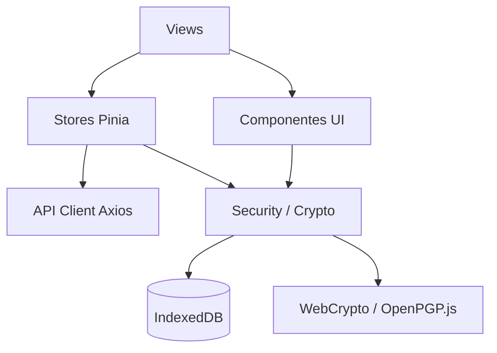
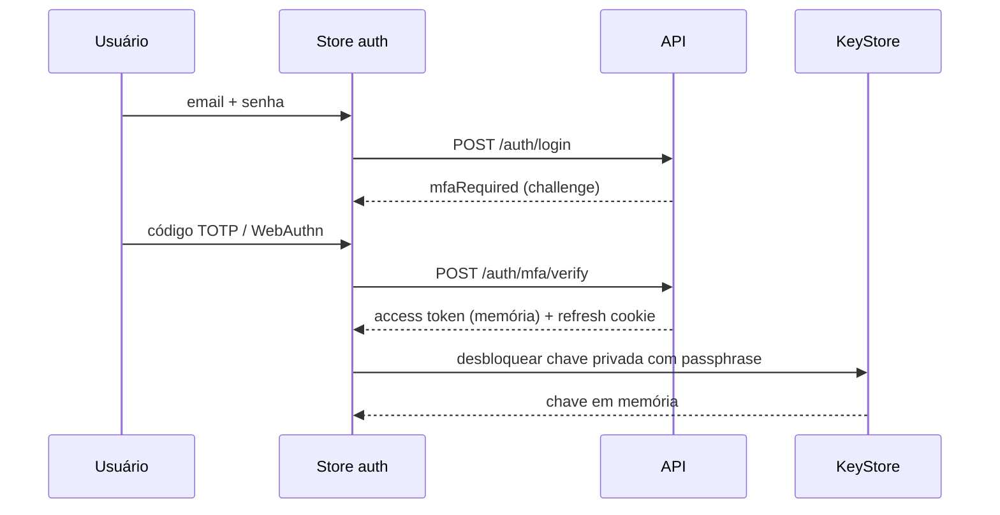

# Frontend — Vue 3

## 1. Visão geral

SPA em **Vue 3 + TypeScript + Composition API + Vite + Vue Router + Pinia + Axios**, servida same-origin atrás do Nginx. O frontend é a **única** camada que manipula segredos em claro, chaves privadas e passphrases. O backend nunca recebe esse material.



## 2. Estrutura

```text
frontend/
├── src/
│   ├── app/
│   │   ├── router/
│   │   ├── layouts/
│   │   └── providers/
│   ├── assets/
│   ├── components/
│   │   ├── ui/            # Design System: Button, Input, Modal, Toast, Table...
│   │   └── shared/        # ResourceRow, PermissionBadge, EmptyState...
│   ├── composables/       # useAuth, usePermissions, useClipboard, useConfirm
│   ├── stores/            # auth, resources, folders, groups, sharing, ui
│   ├── services/          # http, resources, secrets, sharing, auth, admin
│   ├── security/
│   │   ├── openpgp/       # wrapper auditado
│   │   ├── key-store/     # IndexedDB + memória
│   │   ├── secret-codec/  # serialização por resource type
│   │   ├── kdf/           # Argon2id/PBKDF2
│   │   └── clipboard.ts
│   ├── modules/
│   │   ├── authentication/
│   │   ├── dashboard/
│   │   ├── resources/
│   │   ├── folders/
│   │   ├── groups/
│   │   ├── sharing/
│   │   ├── users/
│   │   ├── settings/
│   │   └── administration/
│   ├── types/
│   └── utils/
└── package.json
```

## 3. Módulos e telas

| Módulo | Telas | Responsabilidade |
|---|---|---|
| authentication | Login, MFA, recuperação, setup inicial | Identidade e sessão |
| dashboard | Visão geral, favoritos, recentes, alertas | Atalhos e status |
| resources | Cofre, lista, detalhes, criar/editar | CRUD de credenciais |
| folders | Árvore, mover, permissões da pasta | Organização |
| groups | Lista, membros, gestores, rekey | Times |
| sharing | Diálogo de compartilhamento, operações pendentes | Compartilhar/revogar |
| users | Lista, convite, status, chaves | Administração de pessoas |
| settings | Perfil, segurança, dispositivos, chaves | Conta |
| administration | Configurações, auditoria, retenção | Admin |

### Rotas

| Rota | Tela | Guarda |
|---|---|---|
| `/login` | Login | pública |
| `/setup` | Configuração inicial de conta/chave | pública com token de convite |
| `/mfa` | Verificação MFA | parcial |
| `/` | Dashboard | autenticada |
| `/vault` | Lista de recursos | autenticada |
| `/vault/:id` | Detalhe da credencial | autenticada + READ |
| `/vault/new` | Nova credencial | autenticada + UPDATE na pasta |
| `/vault/:id/edit` | Editar credencial | autenticada + UPDATE |
| `/folders` | Gerenciamento de pastas | autenticada |
| `/groups` | Grupos | autenticada + manager |
| `/groups/:id` | Membros do grupo | autenticada + manager |
| `/sharing/pending` | Operações de rekey pendentes | autenticada + OWNER |
| `/users` | Usuários | admin |
| `/settings/security` | MFA, dispositivos, sessões | autenticada |
| `/settings/keys` | Chaves públicas, fingerprint, backup | autenticada |
| `/audit` | Auditoria | admin |
| `/admin` | Administração | admin |

## 4. Stores Pinia

| Store | Estado | Persistência |
|---|---|---|
| `auth` | usuário, sessão, MFA pendente, device | memória + refresh cookie |
| `keyStore` | chave privada desbloqueada (nunca persistida em claro) | IndexedDB (cifrada) |
| `resources` | lista, filtros, paginação, seleção | memória |
| `folders` | árvore, expansões | memória |
| `groups` | grupos, membros | memória |
| `sharing` | operações pendentes, fila de rekey | memória |
| `ui` | toasts, modais, tema, sidebar | localStorage (não sensível) |

**Regra**: access token vive **somente em memória** (módulo `services/http.ts`), nunca em `localStorage`/`sessionStorage`. O refresh token é cookie `HttpOnly; Secure; SameSite=Strict` do mesmo domínio.

## 5. Camada de segurança (`src/security`)

### 5.1 Key store

- Chave privada OpenPGP é gerada no navegador durante o setup.
- Armazenada em `IndexedDB` **cifrada** com AES-256-GCM, usando chave derivada da passphrase (Argon2id, 19 MiB, t=2, p=1 — constantes versionadas). O OpenPGP.js serializa o bloco de chave; o envelope AES-GCM é a camada de persistência.
- Após desbloqueio, a chave fica **apenas em memória** com timeout configurável (padrão 15 min, renovável).
- `beforeunload`/`visibilitychange` limpam o material sensível da memória quando o timeout expira.

### 5.2 OpenPGP wrapper

- Biblioteca: `openpgp` (OpenPGP.js) — implementação auditada, sem primitivas próprias.
- Algoritmos padrão: `curve25519` (ECDH/EdDSA) + AES-256 + SHA-256.
- Operações expostas:
  - `generateKey({ userIds, passphrase })`
  - `encryptFor({ data, recipientKeys, signerKey, formatVersion })`
  - `decryptWith({ armored, privateKey })`
  - `sign / verify`
  - `fingerprint(armoredKey)`
- Toda saída inclui `formatVersion` e `keyFingerprint`.

### 5.3 Secret codec

O conteúdo em claro é um JSON que obedece ao schema do `resource_type`. O codec:

1. Valida o JSON contra o schema (client-side; o servidor não consegue validar).
2. Serializa de forma determinística (chaves ordenadas, UTF-8).
3. Cifra com OpenPGP para cada destinatário.
4. Retorna envelopes + metadados (fingerprint, algoritmo, versão).

### 5.4 Clipboard

- `navigator.clipboard.writeText` com limpeza automática em 30 s.
- Fallback com `document.execCommand` apenas se a API não existir.
- Feedback visual "Copiado" e opção "Limpar agora".
- Nunca copiar a chave privada ou passphrase.

### 5.5 Revelação controlada

- Segredo oculto por padrão (`type="password"`).
- Botão de revelar exige usuário autenticado e, opcionalmente, reautenticação (política de step-up).
- Auto-ocultar após 30 s de inatividade.
- Nunca renderizar segredo em atributo `title`, `data-*` ou log do Vue.

## 6. Fluxo de autenticação no frontend



- Rota protegida sem access token → tenta `POST /auth/refresh`; se falhar, redireciona para `/login`.
- 401 em qualquer chamada → renovação única (single-flight) e retry da requisição original.
- Logout revoga sessão no backend e limpa memória/IndexedDB não essencial.

## 7. Tratamento de estados

| Estado | Componente |
|---|---|
| Carregando | Skeleton + `aria-busy="true"` |
| Vazio | `EmptyState` com ação primária |
| Erro | `ErrorState` com `requestId` e ação "Tentar novamente" |
| Sem permissão | Estado dedicado, sem revelar existência do recurso |
| Desatualizado | Banner "Nova versão disponível" + recarregar |
| Rekey pendente | Banner persistente em `/sharing/pending` |

## 8. Responsividade e acessibilidade

- Breakpoints: 360, 768, 1024, 1440.
- Navegação por teclado, foco visível, `aria-live` para toasts.
- Contraste mínimo AA.
- Alvos de toque ≥ 44 px.
- Tabelas com cabeçalho fixo e rolagem horizontal acessível.

## 9. Serviço HTTP

- Axios com `baseURL: '/api/v1'`, `withCredentials: true`.
- Interceptor de request: adiciona `Authorization: Bearer <memória>` e `Idempotency-Key` quando aplicável.
- Interceptor de response: normaliza erro Problem Details, dispara refresh em 401, expõe `requestId`.
- Timeout padrão 15 s; upload de envelope 60 s.
- Cancelamento via `AbortController` ao sair da tela.

## 10. Build, ambiente e qualidade

- Vite + `vue-tsc` no build.
- ESLint + Prettier + `eslint-plugin-security`.
- Vitest + Vue Test Utils; Playwright para E2E.
- Variáveis: `VITE_API_BASE_URL`, `VITE_SERVER_KEY_FINGERPRINT` (pin), `VITE_APP_VERSION`.
- CSP: `default-src 'self'`; `script-src 'self'`; `connect-src 'self'`; sem `unsafe-inline`.
- Nenhum segredo de API no bundle.

## 11. Regras de UX obrigatórias

1. Confirmação para ações destrutivas (excluir recurso, revogar acesso, remover membro).
2. Feedback imediato em toda mutação (toast + estado otimista quando seguro).
3. Nunca revelar segredo automaticamente.
4. Exibir fingerprint da chave do servidor em configurações e alertar em mudança.
5. Exibir "pendente de rekey" quando houver operação não concluída.
6. Não permitir compartilhar sem pelo menos um OWNER remanescente.
7. Ao editar segredo, mostrar lista de destinatários que receberão a nova versão.
8. Ao remover membro de grupo, explicar que o acesso futuro é revogado, mas o histórico pode ter sido copiado.

## 12. Fora de escopo do frontend

- Validar permissões como fonte de verdade (o backend é).
- Descriptografar segredos de outros usuários.
- Armazenar chave privada em texto claro.
- Implementar lógica de rekey sem confirmação do usuário.
- Renderizar segredos em logs/analytics.