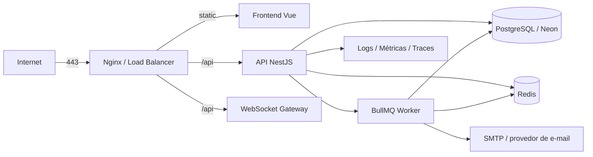

# Infraestrutura

## 1. Topologia



## 2. Serviços

| Serviço | Imagem | Função | Persistência |
|---|---|---|---|
| `web` | nginx:alpine | Reverse proxy, TLS, estáticos | — |
| `api` | node:22-alpine (build) | NestJS | — |
| `worker` | mesma imagem da API | BullMQ | — |
| `postgres` | postgres:17-alpine (ou Neon gerenciado) | Fonte de verdade | Volume |
| `redis` | redis:7-alpine | Cache, filas, rate limit | AOF desligado |
| `mailhog` (dev) | mailhog | Captura de e-mails | — |
| `pgadmin` (dev) | dpage/pgadmin4 | Diagnóstico | — |

## 3. Docker Compose (rascunho)

```yaml
x-api-env: &api-env
  DATABASE_URL: ${DATABASE_URL}
  REDIS_URL: ${REDIS_URL}
  TOTP_ENC_KEY: ${TOTP_ENC_KEY}
  SMTP_URL: ${SMTP_URL}
  SERVER_KEY_PATH: /run/secrets/server_private.asc
  JWT_PRIVATE_KEY_PATH: /run/secrets/jwt_private.pem
  JWT_PUBLIC_KEY_PATH: /run/secrets/jwt_public.pem

services:
  web:
    image: nginx:1.27-alpine
    ports: ["80:80", "443:443"]
    volumes:
      - ./infra/nginx/nginx.conf:/etc/nginx/nginx.conf:ro
      - ./frontend/dist:/usr/share/nginx/html:ro
      - ./infra/tls:/etc/nginx/tls:ro
    depends_on: [api]
    healthcheck:
      test: ["CMD", "wget", "-qO-", "http://127.0.0.1/healthz"]
      interval: 10s
      timeout: 3s
      retries: 3

  api:
    build: ./backend
    environment:
      <<: *api-env
      NODE_ENV: production
    secrets: [jwt_private, jwt_public, server_key]
    depends_on:
      postgres: { condition: service_healthy }
      redis: { condition: service_healthy }
    healthcheck:
      test: ["CMD", "node", "-e", "fetch('http://127.0.0.1:3000/health/ready').then(r=>process.exit(r.ok?0:1)).catch(()=>process.exit(1))"]
      interval: 15s
      timeout: 5s
      retries: 5

  worker:
    build: ./backend
    command: ["node", "dist/infrastructure/queue/worker.js"]
    environment:
      <<: *api-env
      NODE_ENV: production
    secrets: [jwt_private, jwt_public, server_key]
    depends_on: [redis, postgres]

  postgres:
    image: postgres:17-alpine
    environment:
      POSTGRES_DB: securevault
      POSTGRES_USER: securevault
      POSTGRES_PASSWORD: ${POSTGRES_PASSWORD}
    volumes: ["pgdata:/var/lib/postgresql/data"]
    healthcheck:
      test: ["CMD-SHELL", "pg_isready -U securevault"]
      interval: 5s
      timeout: 3s
      retries: 10

  redis:
    image: redis:7-alpine
    command: ["redis-server", "--appendonly", "no", "--maxmemory", "256mb", "--maxmemory-policy", "allkeys-lru"]
    healthcheck:
      test: ["CMD", "redis-cli", "ping"]
      interval: 5s
      timeout: 3s
      retries: 5

volumes:
  pgdata:

secrets:
  jwt_private:
    file: ./infra/secrets/jwt_private.pem
  jwt_public:
    file: ./infra/secrets/jwt_public.pem
  server_key:
    file: ./infra/secrets/server_private.asc
```

> Em produção, usar PostgreSQL gerenciado (Neon) com PITR e Redis gerenciado; o Compose serve para desenvolvimento e testes de integração.

## 4. Nginx

Responsabilidades:

- TLS (certificado gerenciado) e HSTS.
- Servir a SPA com cache imutável para assets (`/assets/*`, 1 ano).
- Proxy `/api` e `/socket.io` para `api`.
- Rate limit adicional em `/api/v1/auth`.
- Headers de segurança.
- `client_max_body_size 2m` (ajustável; envelopes de segredo são pequenos).
- Desabilitar listagem de diretório.
- Health check `/healthz`.

Exemplo de política de cache:

| Recurso | Cache |
|---|---|
| `index.html` | `no-cache` |
| `/assets/*` | `public, max-age=31536000, immutable` |
| `/api/*` | `no-store` |
| `/api/docs` | `no-store` |

## 5. Variáveis de ambiente

| Chave | Obrigatória | Descrição |
|---|---|---|
| `NODE_ENV` | sim | `development`/`test`/`production` |
| `PORT` | não | default 3000 |
| `DATABASE_URL` | sim | PostgreSQL |
| `REDIS_URL` | sim | Redis |
| `JWT_PRIVATE_KEY_PATH` / `JWT_PUBLIC_KEY_PATH` | sim | Par Ed25519 |
| `JWT_ACCESS_TTL` | não | default `15m` |
| `JWT_REFRESH_TTL` | não | default `30d` |
| `TOTP_ENC_KEY` | sim | 32 bytes base64 |
| `SERVER_KEY_PATH` | sim | Chave privada OpenPGP do servidor |
| `SERVER_KEY_FINGERPRINT` | sim | Fingerprint público para pin |
| `SMTP_URL` | produção | E-mail transacional |
| `WEB_ORIGIN` | produção | Origem permitida |
| `SESSION_COOKIE_DOMAIN` | não | default host |
| `AUDIT_RETENTION_DAYS` | não | default 365 |
| `SECRET_VERSION_RETENTION_DAYS` | não | default 30 |
| `RATE_LIMIT_*` | não | tuning |
| `LOG_LEVEL` | não | `info` em produção |

**Regras**:

- Nunca versionar `.env`, chaves privadas ou senhas.
- `.env.example` com placeholders.
- Validação de env no boot (zod).
- Segredos via Docker secrets/KMS em produção.

## 6. CI/CD

```mermaid
flowchart LR
    P[Pull Request] --> L[Lint + Typecheck]
    L --> U[Unit tests]
    U --> I[Integration tests\nPostgres + Redis]
    I --> A[API tests]
    A --> B[Build backend/frontend]
    B --> D[Build Docker image]
    D --> S[SBOM + image scan]
    S --> E[Deploy staging]
    E --> F[E2E + smoke]
    F --> G[Aprovação manual]
    G --> H[Deploy produção\nmigrate deploy]
```



### Pipeline (GitHub Actions)

1. `lint`: ESLint, Prettier, `prisma format`.
2. `typecheck`: `tsc --noEmit`, `vue-tsc`.
3. `test:unit`.
4. `test:integration` com serviços Postgres 17 + Redis 7.
5. `test:api` com Supertest.
6. `build`.
7. `docker build` + `trivy image`.
8. `migrate deploy` em staging.
9. E2E Playwright (smoke) em staging.
10. Deploy produção com aprovação manual.

### Gates

- Nenhum merge com typecheck, lint ou testes vermelhos.
- Cobertura mínima nos módulos críticos.
- Nenhuma vulnerabilidade crítica/alta sem exceção registrada.
- Nenhuma migration destrutiva sem revisão.

## 7. Observabilidade

| Sinal | Implementação |
|---|---|
| Logs | pino JSON, `requestId`, redaction, retenção 30 dias |
| Métricas | Prometheus: HTTP, filas, DB pool, cache hit |
| Traces | OpenTelemetry → collector |
| Health | `/health/live` (processo), `/health/ready` (DB, Redis, fila) |
| Alertas | erro 5xx, fila com falhas, latência p95, disco, replicação |
| Dashboards | auth, resources, sharing, audit |

## 8. Banco de dados

- PostgreSQL 17 gerenciado (Neon) em produção.
- PITR 7–30 dias (conforme plano).
- Backup lógico diário em object storage (criptografado), retenção 30 dias.
- Teste de restore trimestral documentado.
- Migrations versionadas com Prisma; `migrate deploy` no deploy.
- Pool de conexões: PgBouncer/Neon pooler; `connection_limit` configurável.
- Índices e constraints revisados por migration.

## 9. Escalabilidade

| Nível | Ação |
|---|---|
| API stateless | Escalar réplicas atrás do Nginx |
| Sessões | Sem estado local; refresh token no Postgres |
| Filas | Worker separado, réplicas conforme backlog |
| Redis | Cache não sensível, rate limit, filas |
| Postgres | Read replica para consultas de auditoria/listas; escrita primária |
| Busca | Índice GIN/tsvector; migração futura para OpenSearch se necessário |
| WebSocket | Redis adapter; sticky sessions opcionais |

**Limites**: E2EE impede re-criptografia no servidor; operações de rekey dependem de clientes online. Projetar UX para operações em lote e retentativa.

## 10. Ambientes

| Ambiente | Banco | Objetivo |
|---|---|---|
| Local | Postgres/Redis Docker | Desenvolvimento |
| Test | Postgres/Redis efêmeros | CI |
| Staging | Neon branch + Redis | Homologação |
| Produção | Neon + Redis gerenciado | Real |

## 11. Runbook mínimo

- **Deploy**: `docker compose pull && docker compose up -d --no-deps api worker web`; migrations antes do tráfego.
- **Rollback**: imagem anterior + `prisma migrate resolve` (se aplicável); nunca reverter schema sem plano.
- **Rotacionar chave do servidor**: gerar nova, publicar JWKS, manter antiga para verificação, revogar após janela.
- **Restaurar backup**: provisionar branch Neon/PITR, validar checksum, apontar staging, smoke test.
- **Incidente de segurança**: revogar sessões, rotacionar chaves expostas, auditar acessos, preservar logs.

## 12. Segurança operacional

- Acesso ao banco via bastion/VPN; sem IP público aberto.
- Least privilege de DB: usuário da app sem `DROP`/`ALTER`; migrations com usuário separado.
- Imutabilidade de imagens; assinatura de imagem.
- Nginx com WAF/regras OWASP (opcional).
- Segredos em KMS/Vault; nunca em variáveis de repositório.
- Backups criptografados com chave separada.
- Monitorar tentativas de login e anomalias.