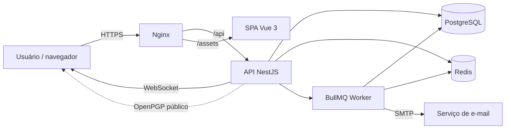
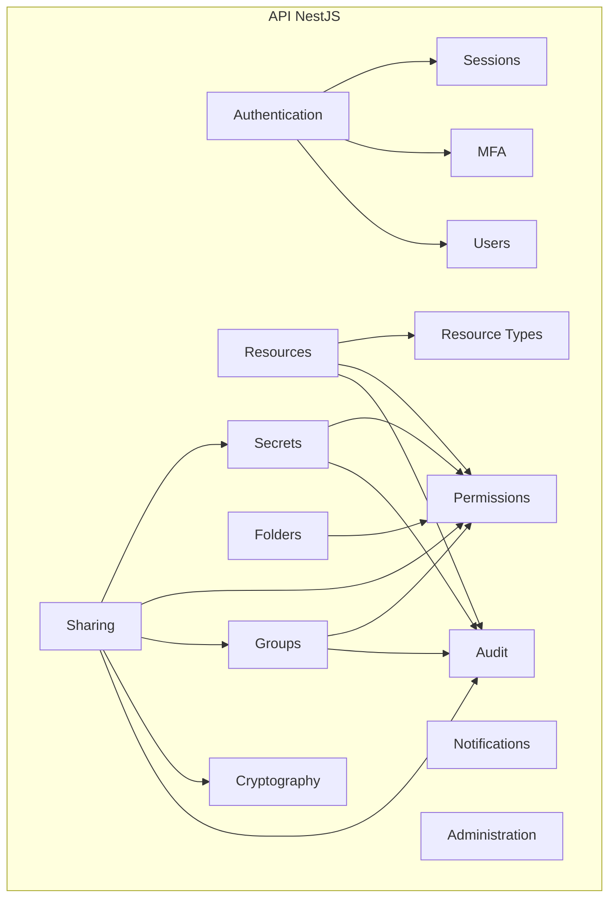

# Visão Geral da Arquitetura

## 1. Contexto

O **SecureVault** é um sistema web para armazenar, organizar e compartilhar credenciais de forma segura entre usuários e grupos. O modelo de segurança segue o princípio *zero-knowledge* do lado do servidor: o backend nunca tem acesso ao conteúdo em claro de senhas, chaves privadas ou passphrases.

O sistema é inspirado no Passbolt, mas **não é uma cópia**: a implementação é própria, em NestJS/TypeScript, com modelo de domínio, banco de dados e contratos definidos do zero.

### Objetivos

- Armazenar credenciais com criptografia ponta a ponta (E2EE).
- Compartilhar credenciais com usuários e grupos, com permissões granulares.
- Organizar credenciais em pastas com herança de permissões como *template*.
- Suportar múltiplos dispositivos por usuário.
- Permitir auditoria completa de operações sensíveis.
- Ser modular, testável e evoluir sem microsserviços prematuros.

### Não objetivos (nesta fase)

- Multi-tenancy (uma organização por instalação).
- Aplicativo móvel nativo.
- Criptografia de metadados (roadmap, formato v2).
- Sincronização offline completa.
- Integração com provedores de identidade (SSO/SAML) — apenas desenhada como extensão.

## 2. Contexto do sistema

- O **cliente** gera e guarda a chave privada, descriptografa segredos e assina operações.
- A **API** valida identidade, autorização, integridade estrutural e persiste apenas material cifrado/opaco.
- O **worker** executa tarefas assíncronas não criptográficas (e-mail, notificações, expurgo, projeções de auditoria).
- O **PostgreSQL** é a fonte de verdade. O **Redis** guarda apenas dados efêmeros e não sensíveis.

## 3. Princípios arquiteturais

1. **E2EE por envelope**: cada segredo é cifrado individualmente para cada destinatário autorizado.
2. **Servidorburro para segredos**: o backend não descriptografa nem deriva chaves de usuários.
3. **Modular Monolith**: módulos independentes, comunicação por contratos e eventos.
4. **Clean Architecture + DDD**: dependências apontam para o domínio.
5. **Autorização centralizada**: nenhuma regra de permissão em controller.
6. **Fail-closed**: na dúvida, negar acesso.
7. **Idempotência**: operações repetíveis (share, rekey, criação) usam chave de idempotência.
8. **Observabilidade sem vazamento**: logs estruturados nunca contêm segredos.
9. **Versionamento criptográfico**: todo material cifrado declara versão de formato/algoritmo.
10. **Simplicidade primeiro**: sem microsserviços, sem CQRS, sem event sourcing até haver necessidade comprovada.

## 4. Módulos e responsabilidades

| Módulo | Responsabilidade | Fora do escopo |
|---|---|---|
| Authentication | Login, MFA, sessão, recuperação, força bruta | Autorização de recursos |
| Users | Identidade, perfil, status, chaves públicas | Criptografia de segredos |
| Cryptography | Registro/validação de chaves públicas, fingerprints, chave do servidor, validação de envelope | Cifrar/decifrar segredos de usuários |
| Resource Types | Schemas versionados de credenciais | Validar conteúdo cifrado |
| Resources | Metadados não secretos, ciclo de vida, busca | Conteúdo sensível |
| Secrets | Persistência de envelopes cifrados, versões | Descriptografia |
| Folders | Hierarquia e permissões-template | Impor permissão continuamente |
| Groups | Times, membros, gestores | Cifrar material para membros |
| Permissions | Matriz READ/UPDATE/OWNER, resolução efetiva | Regras de negócio de outros módulos |
| Sharing | Orquestração de compartilhamento, revogação, rekey | Gerar material criptográfico |
| Audit | Registro e consulta de eventos | Mutar domínio alheio |
| MFA | TOTP, WebAuthn, códigos de recuperação | Login primário |
| Sessions | Refresh tokens, dispositivos, revogação | Autorização |
| Notifications | Notificações in-app e e-mail | Decidir permissões |
| Administration | Usuários admin, configurações, retenção, rotação | Operar infraestrutura |

A matriz completa de dependências permitidas está em `architecture/backend.md`.

## 5. Atributos de qualidade

| Atributo | Meta | Como |
|---|---|---|
| Segurança | Nenhum segredo em claro no servidor | E2EE, envelope por destinatário, auditoria |
| Integridade | Nenhuma operação sem autorização válida | Policy central, transações, constraints |
| Disponibilidade | 99,9% | Health checks, retries, fila |
| Escalabilidade | 10k usuários / 1M recursos | Índices, paginação, cache não sensível |
| Manutenibilidade | Módulos testáveis isoladamente | Clean Architecture, contratos |
| Auditabilidade | 100% das ações sensíveis | Audit log append-only |
| Portabilidade | Subir com Docker Compose | Imagens, env vars |

## 6. Invariantes de domínio

Estas regras valem para **toda** operação, independentemente da origem (API, worker, job):

1. Um recurso existe apenas se tiver **pelo menos um OWNER** ativo.
2. Uma pasta existe apenas se tiver **pelo menos um OWNER** ativo.
3. Um grupo tem **pelo menos um MANAGER** ativo.
4. Um segredo só pode ser recuperado por usuário com permissão efetiva **READ** ou superior.
5. Toda versão de segredo possui exatamente um envelope cifrado por usuário com acesso.
6. Nenhum envelope é criado para usuário sem chave pública válida e ativa.
7. A revogação de acesso remove a capacidade de descriptografar **versões futuras** e apaga os envelopes da versão corrente.
8. Nenhuma operação de leitura de segredo ocorre sem registro de auditoria (quando a política exigir).
9. Permissão efetiva = **máximo** entre permissão direta do usuário e permissões de grupos.
10. Permissão de pasta nunca é aplicada retroativamente de forma contínua: é um *template* aplicado em operações explícitas.
11. Nenhuma passphrase, chave privada ou segredo em claro trafega para o servidor.
12. Todo material cifrado persistido declara `format_version` e `key_fingerprint`.

## 7. Riscos arquiteturais

| Risco | Impacto | Mitigação |
|---|---|---|
| Perda da chave privada/passphrase | Acesso permanente aos segredos | Recovery kit + escrow opcional cifrado + ADR explícito |
| Cliente desatualizado | Envelope em formato antigo | Versionamento de formato, matriz de compatibilidade, testes |
| Re-encryption de grupo não concluída | Membro novo sem acesso | Operação PENDING + retentativa pelo cliente + alerta |
| Vazamento em logs | Exposição de segredo | Redaction, allowlist de campos, testes |
| Permissão divergente entre módulos | Acesso indevido | Policy única + testes de autorização |
| Migração de algoritmo | Dados ilegíveis | `format_version` + job de re-criptografia |
| Abuso de API | Negação de serviço / brute force | Rate limit, lockout, WAF |

## 8. Glossário

| Termo | Definição |
|---|---|
| **Resource** | Metadados não secretos de uma credencial. |
| **Secret** | Conteúdo sensível cifrado, versionado. |
| **Envelope** | Cópia de um segredo cifrada para a chave pública de um destinatário. |
| **Recipient** | Usuário que possui uma cópia cifrada de um segredo. |
| **Permission** | Relação entre um ACO (recurso/pasta) e um ARO (usuário/grupo). |
| **Rekey** | Re-criptografar envelopes para novos destinatários ou remover envelopes. |
| **Effective permission** | Maior permissão entre diretas e de grupos. |
| **Format version** | Versão do formato criptográfico (`sv1`, futuro `sv2`). |
| **Server key** | Chave OpenPGP do servidor, usada para identidade/JWKS. |
| **Step-up** | Reautenticação MFA para operações sensíveis. |

## 9. Referências

- Passbolt Security White Paper v5.10 (março/2026).
- Passbolt Docs — Roles and Permissions; How to share resources; Groups; Folders.
- OpenPGP RFC 9580.
- NestJS, Prisma, PostgreSQL, Vue 3, BullMQ — documentação oficial.