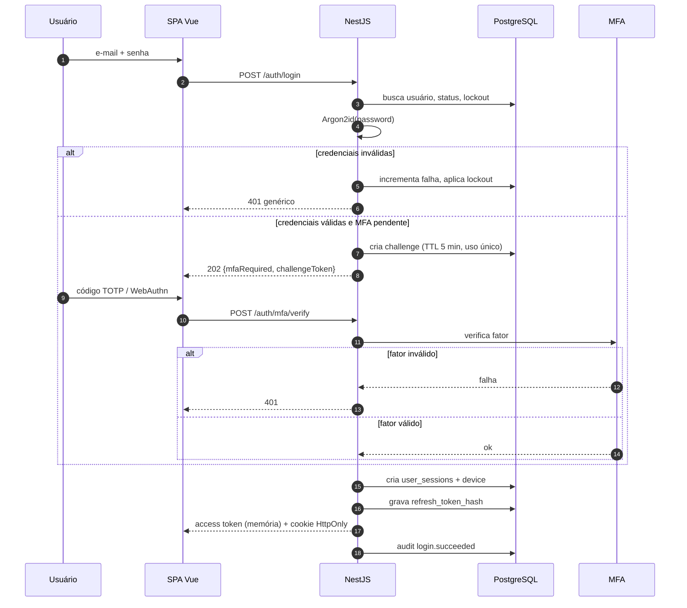
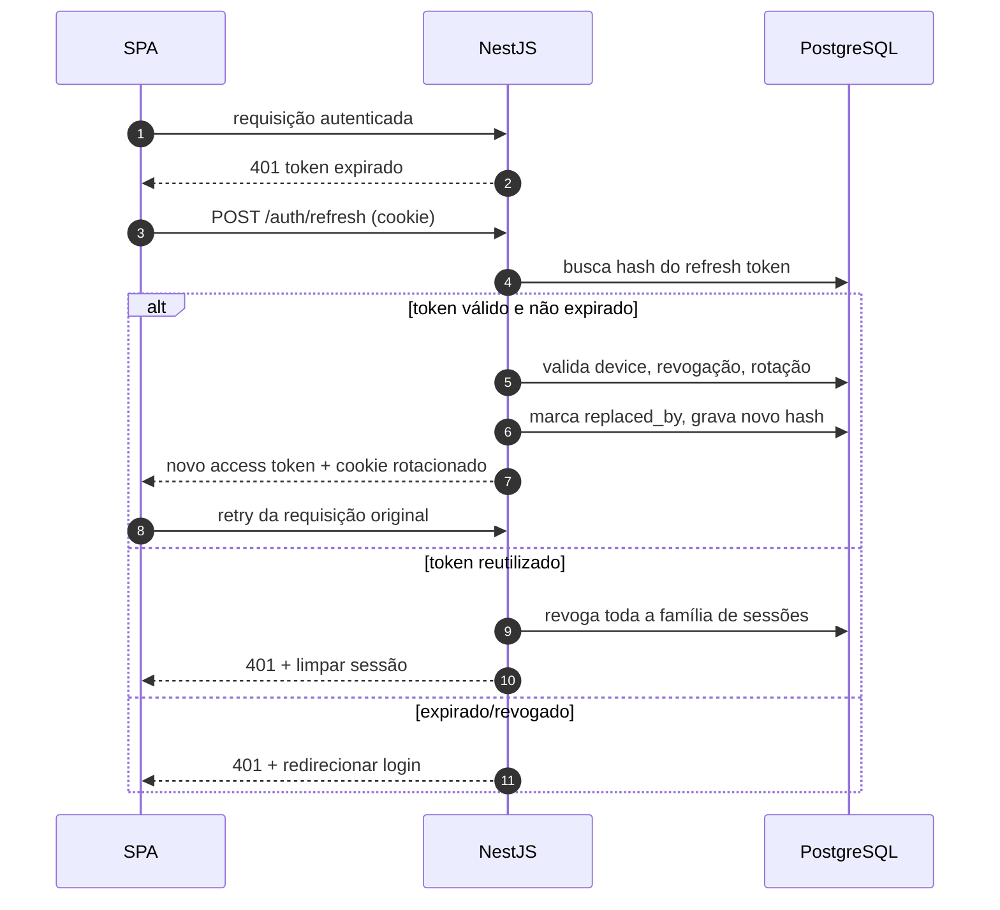
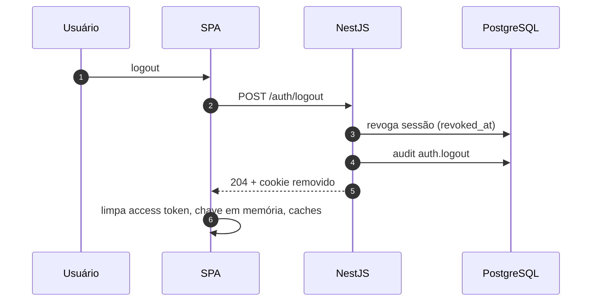
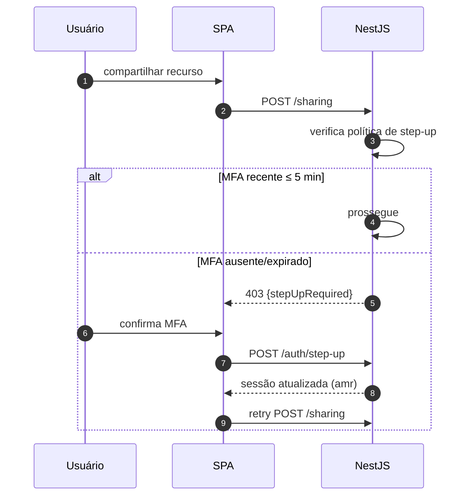
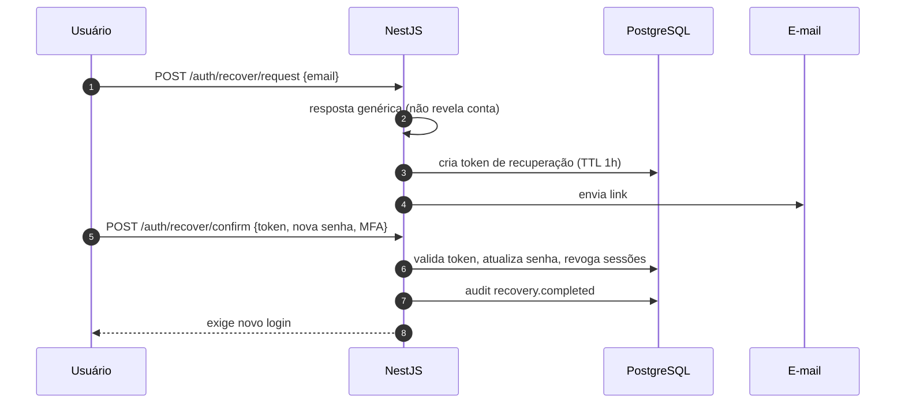
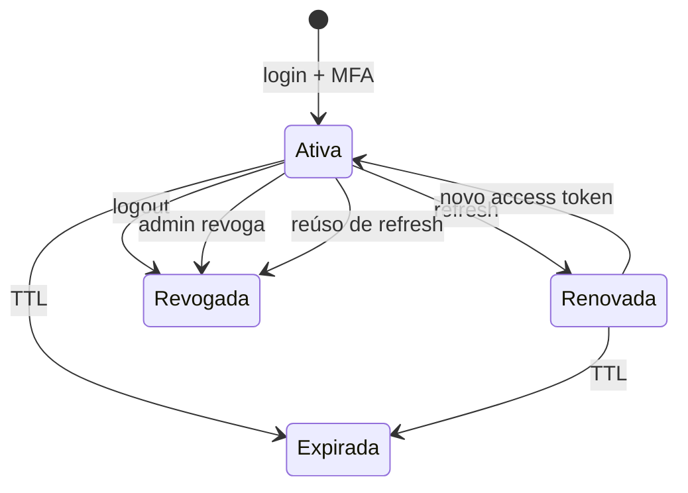

# Diagrama — Fluxo de Autenticação

## 1. Login com senha e MFA

## 2. Renovação de sessão

## 3. Logout e revogação

## 4. Step-up para operação sensível

## 5. Recuperação de acesso

## 6. Estados de uma sessão

## 7. Pontos de controle

| Ponto | Controle |
|---|---|
| Senha | Argon2id + lockout + rate limit |
| MFA | TOTP/WebAuthn + replay protection |
| Access token | 15 min, memória, `sid`/`deviceId` |
| Refresh | httpOnly, rotação, reúso revoga família |
| Sessão | revogável por usuário/admin |
| Dispositivo | device_id + notificação de novo device |
| Step-up | operações sensíveis |
| Auditoria | login, falha, logout, MFA, recuperação |