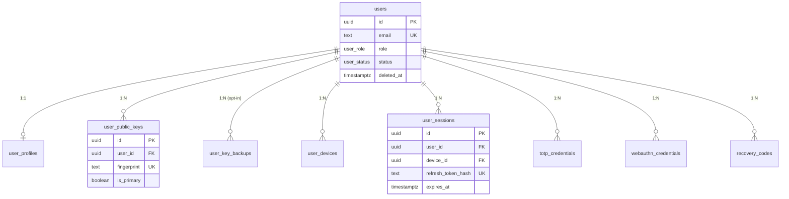
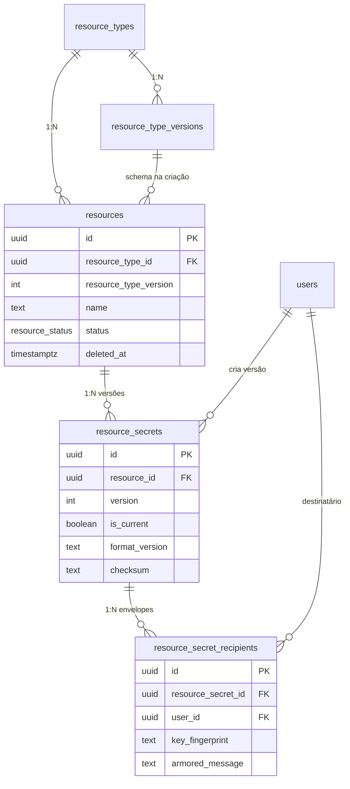
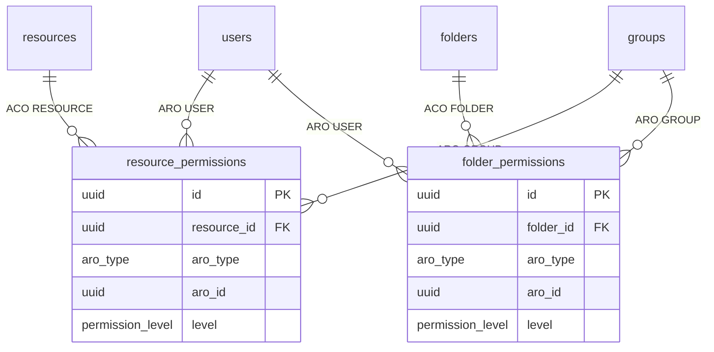
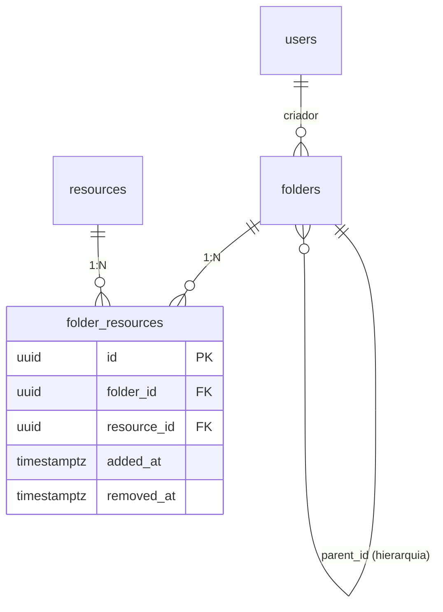
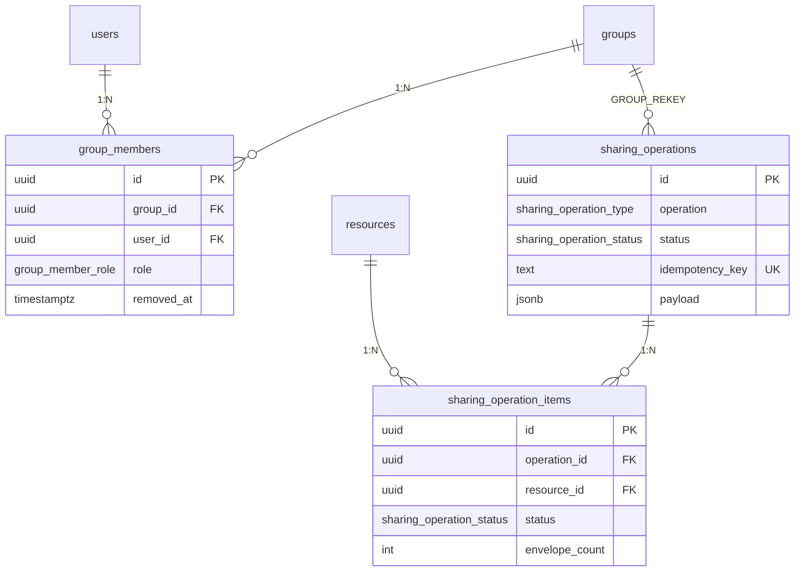
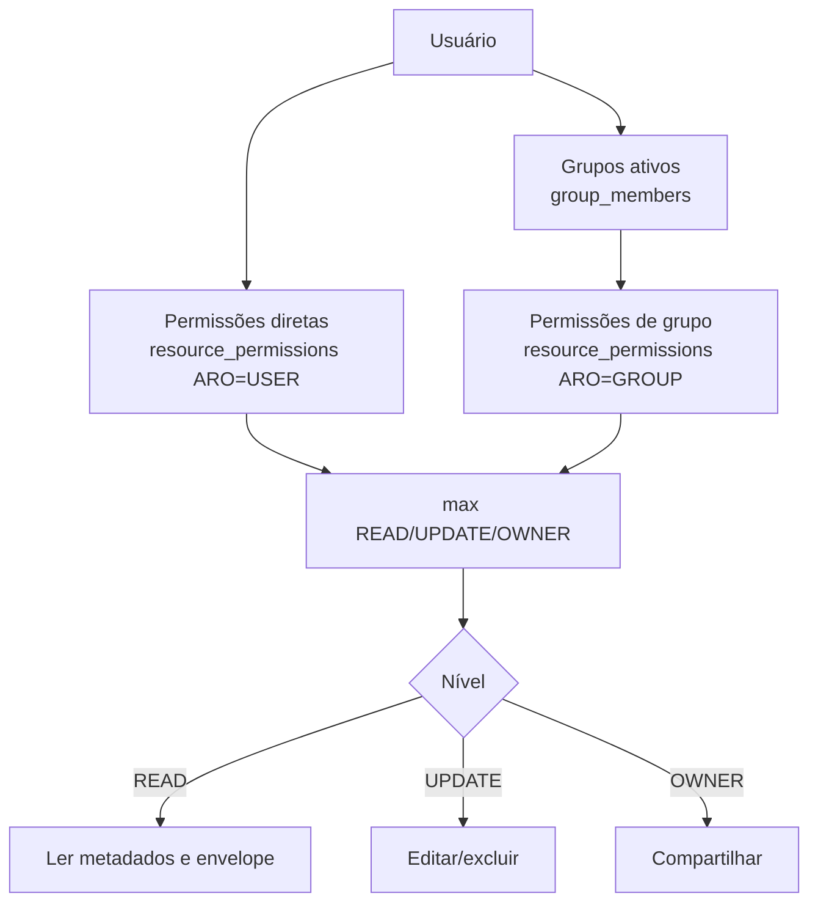
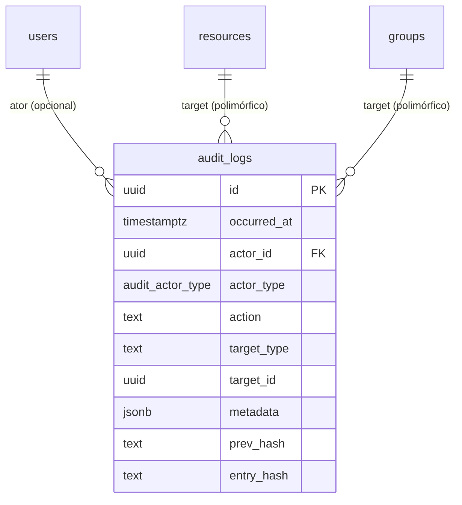

# Diagrama — Entidade-Relacionamento

> Visão complementar ao `architecture/database.md`. Aqui o foco é a leitura dos relacionamentos e da resolução de permissão.

## 1. Núcleo de identidade

## 2. Recursos, segredos e destinatários

## 3. Permissões polimórficas

> `aro_id` não possui FK por ser polimórfico; a aplicação valida `USER` ativo ou `GROUP` ativo antes de persistir.

## 4. Pastas e organização

> Unique parcial em `(resource_id)` garante **uma pasta ativa por recurso**.

## 5. Grupos e rekey

## 6. Resolução de permissão efetiva

## 7. Auditoria

## 8. Observações de modelagem

1. Permissões são **polimórficas**, não uma tabela por tipo de ARO.
2. Segredos são **versionados** e possuem **um envelope por usuário**.
3. Grupos não possuem envelope: possuem permissão; o envelope é materializado por membro.
4. `folder_resources` garante uma única pasta ativa por recurso, com histórico de movimentação.
5. Auditoria é polimórfica por `target_type`/`target_id` e append-only.
6. Sessões consolidam refresh tokens; não há tabela separada.