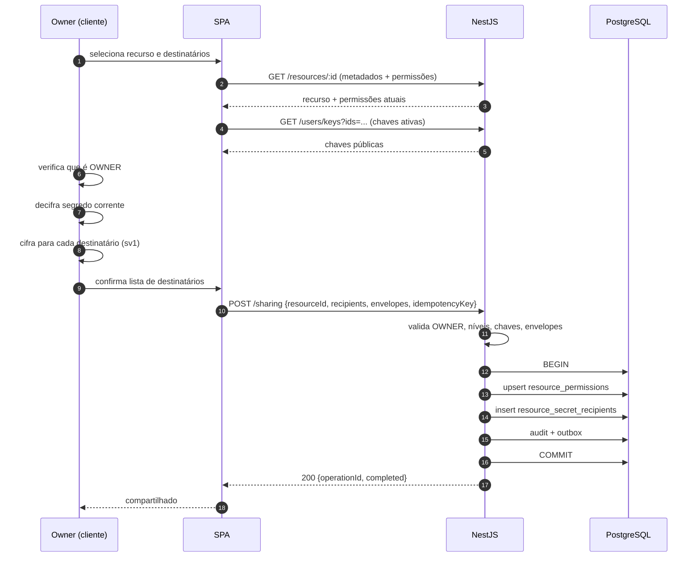
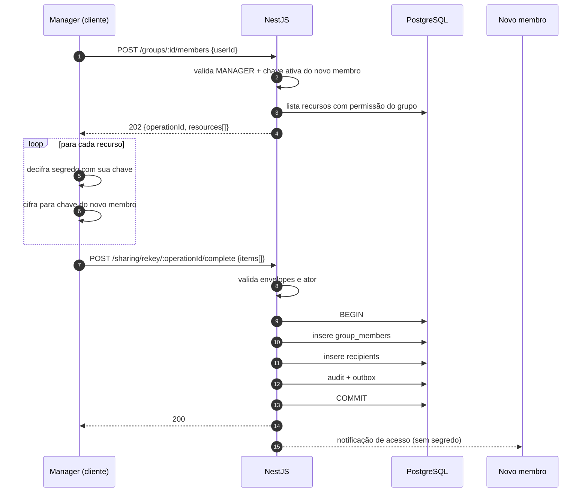
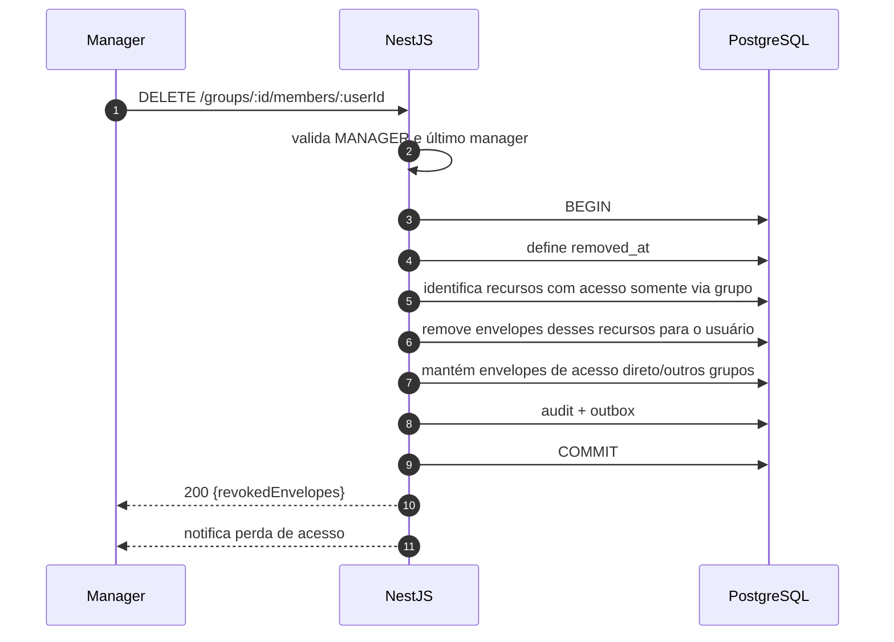
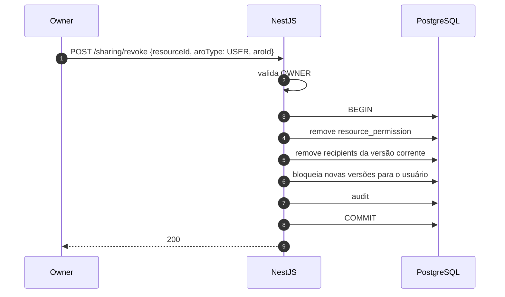
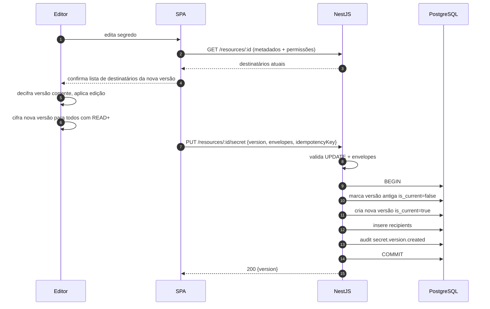
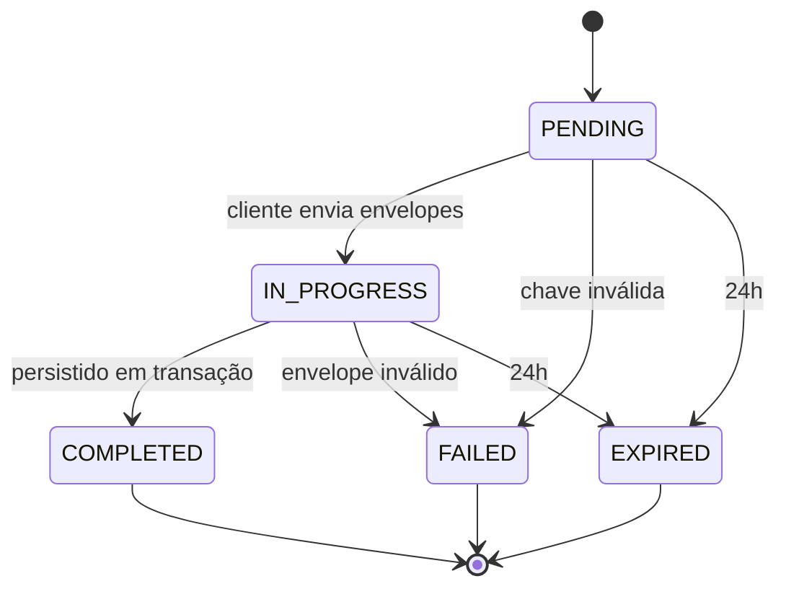

# Diagrama — Fluxo de Compartilhamento

## 1. Compartilhar recurso com usuários e grupos

## 2. Grupo: adicionar membro (rekey obrigatório)

> Se o cliente não concluir, a operação fica `PENDING`; o membro **não** recebe os envelopes e não consegue decifrar.

## 3. Grupo: remover membro (revogação)

## 4. Revogar usuário de um recurso

## 5. Edição de segredo com re-cifra

## 6. Estados da operação de sharing

## 7. Matriz de decisão

| Operação | Exige | Efeito |
|---|---|---|
| Share usuário | OWNER | permissão + envelopes |
| Share grupo | OWNER | permissão de grupo + envelopes dos membros ativos |
| Add membro grupo | MANAGER + chave do membro | group_members + rekey |
| Remove membro grupo | MANAGER | remove envelopes derivados do grupo |
| Revogar usuário | OWNER | remove permissão + envelopes |
| Downgrade permissão | OWNER | atualiza nível; se perde READ, remove envelopes |
| Editar segredo | UPDATE | nova versão + envelopes para READ+ |
| Excluir recurso | UPDATE | soft delete + revoga envelopes |

## 8. Garantias

- Transação única entre permissão e envelopes.
- Idempotência por `Idempotency-Key`.
- Nenhum acesso concedido antes da conclusão do rekey.
- Nenhum recurso sem OWNER.
- Revogação remove a capacidade de obter versões futuras.
- Auditoria sem ciphertext.