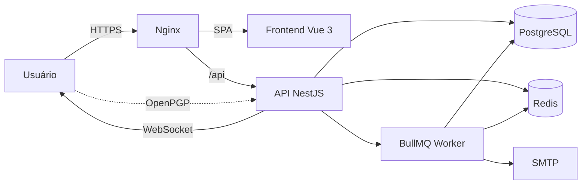
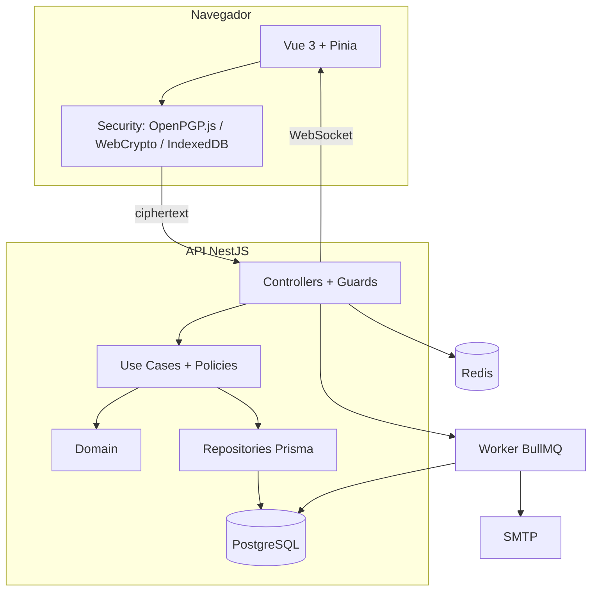
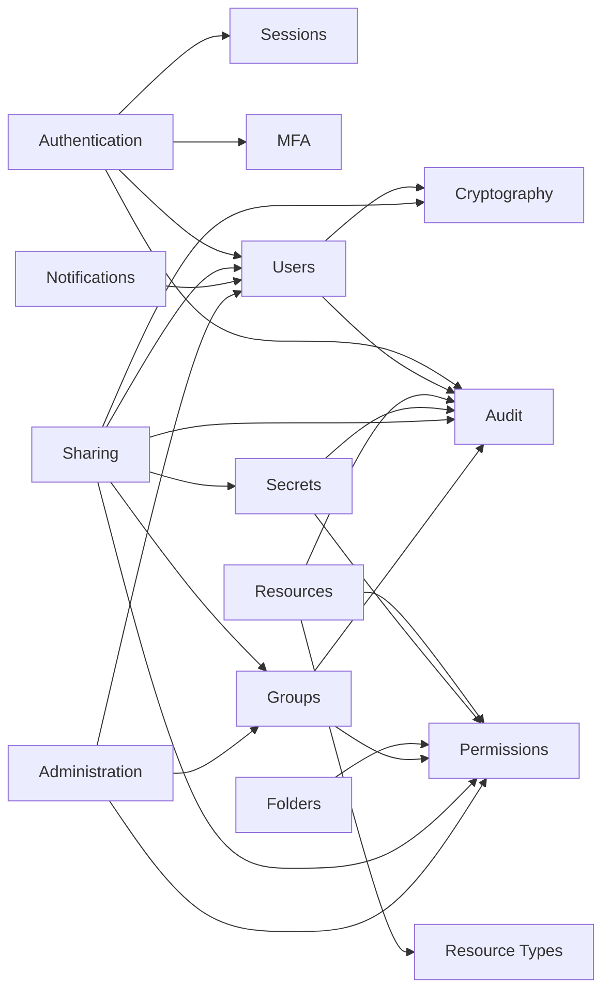
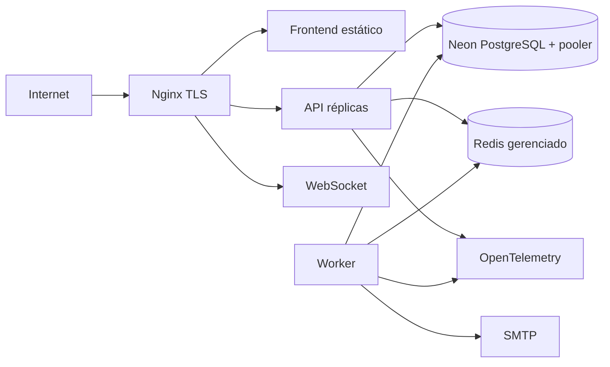
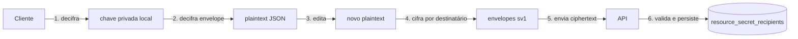

# Diagrama — Arquitetura do Sistema

## 1. Contexto

## 2. Componentes internos

## 3. Dependências entre módulos

## 4. Topologia de deploy

## 5. Fluxo de dados de um segredo

## 6. Fronteiras de confiança

| Zona | Confiança | Conteúdo |
|---|---|---|
| Cliente | Alta (usuário dono da chave) | segredos em claro, chave privada |
| API | Média (autenticada, mas sem chave) | ciphertext, metadados, permissões |
| Banco | Média (criptografia em repouso + acesso restrito) | ciphertext, metadados, audit |
| Redis | Baixa | apenas cache não sensível |
| Worker | Média | notificações, expurgo, projeções; sem segredos |

## 7. Decisões refletidas

- Modular monolith: um único deploy de API + worker.
- E2EE: o cliente é a única zona que vê plaintext.
- Sem microsserviços: fronteiras de módulo, não de processo.
- Escala horizontal da API; worker separado para filas.