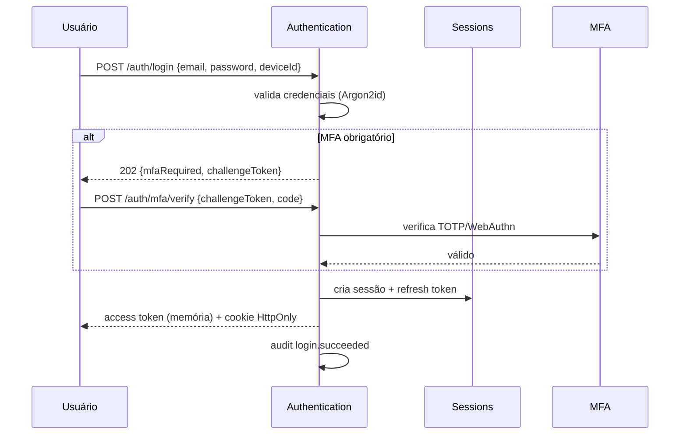

# Domínio — Authentication

## 1. Responsabilidade

Provar a identidade de um usuário e estabelecer uma sessão segura. Authentication **não** decide acesso a recursos; isso é responsabilidade de `Permissions`.

## 2. Fluxo



## 3. Regras de negócio

1. O login exige e-mail e senha válidos, ou um método alternativo habilitado (futuro: desafio de chave).
2. Senhas são verificadas com Argon2id; comparação em tempo constante.
3. A resposta de credenciais inválidas é genérica e não revela se o e-mail existe.
4. Após 5 falhas em 1 minuto por IP ou 10 em 1 hora por conta, a conta entra em lockout exponencial (1, 5, 15, 60 min).
5. Se MFA estiver habilitado para o usuário ou exigido pela organização, o login emite um `challengeToken` de uso único com TTL de 5 minutos.
6. O `challengeToken` não é um access token e não autoriza nenhuma operação.
7. TOTP é válido na janela ±1 passo de 30 s; o passo usado é memorizado para evitar replay.
8. WebAuthn usa challenge single-use, validação de origem e counter crescente.
9. O login bem-sucedido cria uma sessão (`user_sessions`) com `refresh_token_hash`, `device_id`, `ip`, `user_agent`, `amr` e expiração.
10. O access token (JWT) tem TTL de 15 min, contém `sub`, `sid`, `deviceId`, `amr`, `acr` e é mantido apenas em memória no cliente.
11. O refresh token é opaco (256 bits), trafega em cookie `HttpOnly; Secure; SameSite=Strict`, é armazenado hasheado e **rotacionado a cada uso**.
12. Reúso de um refresh token já rotacionado invalida toda a família de sessões (detecção de roubo).
13. Logout revoga a sessão corrente, remove o cookie e registra auditoria.
14. Alteração de senha, suspensão ou exclusão de usuário revoga todas as sessões ativas.
15. Um usuário pode ter no máximo N sessões ativas simultâneas (configurável; default 10); ao exceder, a mais antiga é revogada.
16. Novo dispositivo exige MFA e gera notificação ao usuário.
17. Operações sensíveis podem exigir step-up (MFA recente ≤ 5 min), conforme política.
18. Toda tentativa de login (sucesso ou falha) é auditada com IP, UA, device e `request_id`, sem senha.

## 4. Invariantes

- Um `challengeToken` só pode ser usado uma vez e pertence a um único usuário.
- Nenhum access token é emitido sem sessão válida e MFA satisfeito.
- Nenhum refresh token é armazenado em claro.
- Toda sessão pertence a um dispositivo conhecido.
- Sessão revogada não pode ser renovada.

## 5. Eventos

| Evento | Payload |
|---|---|
| `auth.login.succeeded` | `userId`, `sessionId`, `deviceId`, `amr` |
| `auth.login.failed` | `emailHash`, `reason`, `ip`, `deviceId` |
| `auth.mfa.challenged` | `userId`, `method`, `challengeId` |
| `auth.mfa.verified` | `userId`, `method` |
| `auth.logout` | `userId`, `sessionId` |
| `auth.recovery.requested` | `userId`, `method` |
| `auth.recovery.completed` | `userId`, `method` |

> `emailHash` é um hash com salt, nunca o e-mail em claro, para permitir correlação sem exposição.

## 6. Contratos

```ts
interface AuthenticationService {
  login(input: LoginInput): Promise<LoginResult>;
  verifyMfa(input: MfaVerifyInput): Promise<SessionTokens>;
  refresh(refreshToken: string): Promise<AccessToken>;
  logout(sessionId: string): Promise<void>;
  requestRecovery(email: string): Promise<void>;
  confirmRecovery(token: string, newPassword: string, newMfa: MfaSetup): Promise<void>;
}
```

## 7. Cenários de borda

| Cenário | Comportamento |
|---|---|
| E-mail inexistente | Mesma resposta genérica; rate limit aplicado |
| Conta suspensa | 403 genérico; sessões revogadas |
| Usuário sem senha (convite pendente) | Rejeita login; orienta ativação |
| MFA perdido | Fluxo de recovery com códigos ou aprovação admin |
| Refresh token reutilizado | Revoga família, exige novo login |
| Sessão expirada | Access token renovado uma vez; se falhar, logout |
| Relógio do dispositivo errado | TOTP ±1 passo; orientar sincronização |
| Múltiplos logins | Sessões independentes, limite configurável |

## 8. Testes obrigatórios

- Login válido/inválido, usuário inexistente (sem enumeração).
- Lockout progressivo e expiração.
- MFA TOTP válido, inválido, expirado, replay.
- WebAuthn challenge/assinatura inválidos.
- Rotação de refresh e detecção de reúso.
- Revogação de sessão e logout.
- Step-up em operação sensível.
- Auditoria sem payload sensível.

## 9. Fora de escopo

- Autorização de recursos.
- Cifra/decifra de segredos.
- Biometria local.
- Login social/SSO (extensão futura).