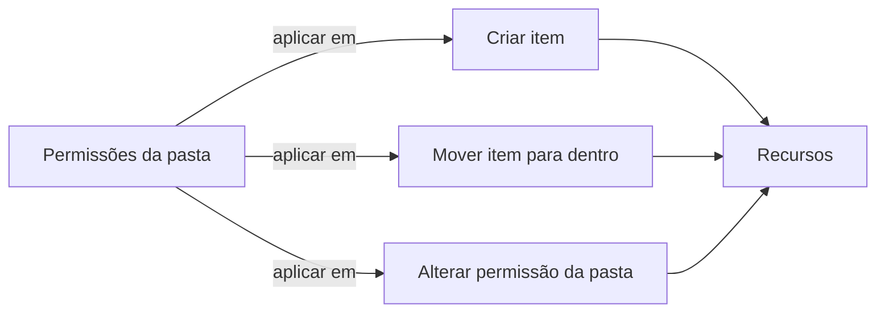

# Domínio — Folders

## 1. Responsabilidade

Organizar recursos em hierarquia e servir como **template de permissões**. Uma pasta não impõe acesso continuamente: ela propaga permissões em operações explícitas de criação, movimentação e alteração de permissão.

## 2. Regras de negócio

1. Toda pasta possui `parent_id` opcional (raiz quando nulo).
2. `name` é obrigatório; nomes duplicados na mesma pasta são rejeitados.
3. A pasta nasce com o criador como **OWNER**.
4. Toda pasta deve ter ao menos um OWNER ativo.
5. A hierarquia não pode conter ciclos: mover uma pasta para dentro de si mesma ou de um descendente é rejeitado.
6. A profundidade máxima é configurável (default 10).
7. A exclusão é soft delete; itens são movidos para a pasta pai ou para a lixeira conforme a operação escolhida.
8. Mover um recurso exige:
   - `UPDATE` no recurso;
   - `UPDATE` na pasta de destino.
9. Mover um recurso **para dentro** de uma pasta aplica a máscara de permissões da pasta, onde o ator tem direito de compartilhar.
10. Mover um recurso **para fora** não remove permissões existentes; a pasta de origem não concede acesso por si só.
11. Alterar permissões de uma pasta aplica a nova máscara a todos os itens onde o ator tem `OWNER` sobre o item.
12. A aplicação de permissão da pasta é idempotente e limitada aos destinatários que o ator pode compartilhar.
13. Um item pode estar em no máximo uma pasta ativa.
14. Pastas não são compartilhadas implicitamente com subpastas: cada pasta tem sua própria lista de permissões.
15. A árvore de pastas é **por usuário**: cada usuário pode ter uma organização diferente dos mesmos recursos.

## 3. Semântica de permissão (template)



| Operação | Efeito |
|---|---|
| Criar recurso na pasta | Novo recurso recebe OWNER do criador + máscara da pasta (quando possível) |
| Mover recurso para a pasta | Aplica máscara da pasta; não remove permissões existentes |
| Alterar permissão da pasta | Reaplica máscara a todos os itens onde o ator é OWNER |
| Mover recurso para fora | Mantém permissões do recurso |
| Excluir pasta | Move itens para a pasta pai ou lixeira |

**Importante**: a pasta é um guia, não um muro. Um recurso pode ter mais permissões que a pasta que o contém, e vice-versa.

## 4. Invariantes

- Nenhuma pasta sem OWNER.
- Nenhum ciclo na hierarquia.
- Nenhum recurso em duas pastas ativas.
- Nenhuma aplicação de permissão fora das três operações acima.
- Nenhuma pasta raiz com `parent_id` apontando para ela mesma.

## 5. Eventos

| Evento | Payload |
|---|---|
| `folder.created.v1` | `folderId`, `parentId`, `ownerId` |
| `folder.updated.v1` | `folderId`, `changedFields[]` |
| `folder.moved.v1` | `folderId`, `fromParentId?`, `toParentId?` |
| `folder.deleted.v1` | `folderId`, `itemsDestination` |
| `folder.permissions.applied.v1` | `folderId`, `appliedCount`, `skippedCount` |

## 6. API

| Método | Rota | Permissão |
|---|---|---|
| GET | `/folders` | READ (filtra por acesso) |
| POST | `/folders` | UPDATE no pai (ou autenticado para raiz) |
| GET | `/folders/:id` | READ |
| PATCH | `/folders/:id` | UPDATE |
| DELETE | `/folders/:id` | UPDATE |
| POST | `/folders/:id/move` | UPDATE na pasta e no destino |
| GET/PUT | `/folders/:id/permissions` | READ / OWNER |

## 7. Contratos

```ts
interface FoldersPublicService {
  getFolder(folderId: string): Promise<Folder>;
  listReadableFolderIds(userId: string): Promise<string[]>;
  getPermissionMask(folderId: string): Promise<EffectivePermission[]>;
  assertNoCycle(folderId: string, newParentId: string | null): Promise<void>;
}
```

## 8. Cenários de borda

| Cenário | Comportamento |
|---|---|
| Mover pasta para descendente | 409 ciclo |
| Excluir pasta com itens | exige destino explícito |
| Alterar permissão sem OWNER no item | item ignorado, contabilizado em `skippedCount` |
| Aplicar máscara a item sem acesso | ignorado |
| Pasta sem OWNER após remoção | 409 |
| Nome duplicado no mesmo pai | 409 |
| Profundidade excedida | 422 |

## 9. Testes obrigatórios

- CRUD e hierarquia.
- Ciclo e profundidade.
- Criação/mover com aplicação de máscara.
- Permissão de pasta não aplicada continuamente.
- Exclusão com itens.
- OWNER obrigatório.
- Concorrência de move.
- Auditoria de aplicação em lote.

## 10. Fora de escopo

- Árvore global compartilhada entre usuários.
- Herança passiva em tempo real.
- Mover em lote (Fase 5, se necessário).