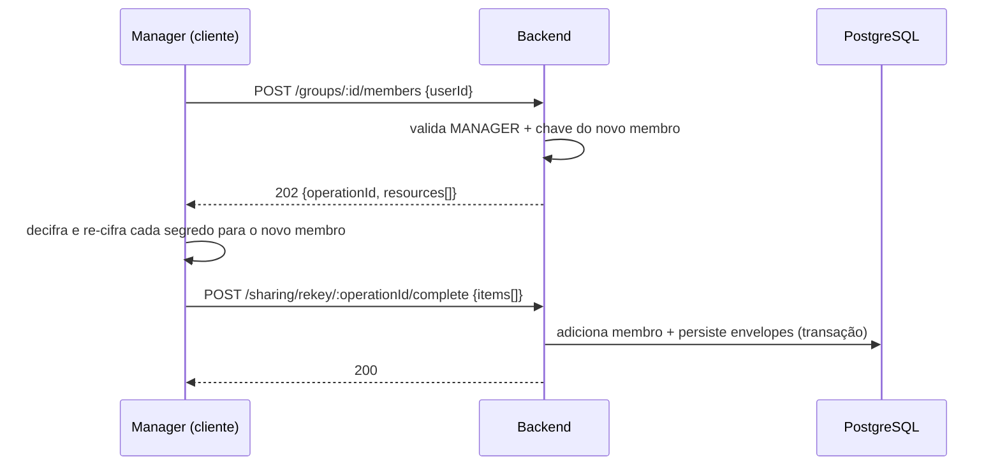

# Domínio — Groups

## 1. Responsabilidade

Representar times de pessoas e servir como ARO (destinatário) de permissões. Um grupo não armazena segredos; ele determina **quem** deve receber envelopes.

## 2. Regras de negócio

1. Todo grupo possui `name` único entre grupos ativos.
2. O criador do grupo é registrado em `created_by` e, por padrão, torna-se MANAGER.
3. Todo grupo deve ter ao menos um MANAGER ativo.
4. Membros possuem papel `MEMBER` ou `MANAGER`.
5. A adição de membro exige que o ator seja MANAGER do grupo e tenha acesso aos segredos compartilhados com o grupo (para re-criptografar).
6. A adição de membro dispara um **rekey obrigatório**:
   - o cliente do manager cifra os segredos do grupo para o novo membro;
   - o backend valida e persiste os envelopes na mesma transação da adição;
   - se o cliente não concluir, a operação fica `PENDING` e o acesso não é concedido até a conclusão.
7. A remoção de membro:
   - revoga sessões? Não necessariamente;
   - remove os envelopes do usuário nos recursos em que o acesso vinha **apenas** do grupo;
   - mantém envelopes de permissões diretas e de outros grupos;
   - remove o acesso futuro;
   - é auditada.
8. Um grupo pode receber permissão em recursos e pastas (`ARO=GROUP`).
9. A permissão efetiva de um usuário em um recurso é o máximo entre sua permissão direta e as permissões dos grupos ativos.
10. A saída de um membro não é rotação de segredo: se o acesso for sensível, o gestor deve trocar a senha.
11. A exclusão de um grupo é soft delete; as permissões de grupo tornam-se inativas e os envelopes derivados são revogados.
12. Nenhum membro pode ser removido se for o último MANAGER.
13. O servidor nunca re-cifra segredos; apenas orquestra e persiste envelopes enviados pelo cliente.

## 3. Invariantes

- Todo grupo ativo tem ao menos um MANAGER.
- Todo membro adicionado tem envelopes criados (ou a operação está PENDING).
- Todo membro removido não possui envelopes derivados apenas do grupo.
- Nenhum grupo sem nome.
- Nenhuma permissão de grupo ativa sem grupo ativo.

## 4. Eventos

| Evento | Payload |
|---|---|
| `group.created.v1` | `groupId`, `ownerId` |
| `group.member.added.v1` | `groupId`, `userId`, `rekeyRequired: true` |
| `group.member.removed.v1` | `groupId`, `userId`, `resourceIds[]` |
| `group.manager.promoted.v1` | `groupId`, `userId` |
| `group.manager.demoted.v1` | `groupId`, `userId` |
| `group.deleted.v1` | `groupId` |

## 5. API

| Método | Rota | Permissão |
|---|---|---|
| GET | `/groups` | autenticado |
| POST | `/groups` | autenticado (ou ADMIN, conforme política) |
| GET | `/groups/:id` | autenticado (membros podem ver) |
| PATCH | `/groups/:id` | MANAGER |
| POST | `/groups/:id/members` | MANAGER + acesso aos segredos |
| DELETE | `/groups/:id/members/:userId` | MANAGER |
| POST | `/groups/:id/managers/:userId` | MANAGER |
| DELETE | `/groups/:id` | MANAGER |

## 6. Contratos

```ts
interface GroupMembershipPort {
  listActiveMemberIds(groupId: string): Promise<string[]>;
  listActiveManagerIds(groupId: string): Promise<string[]>;
  isManager(userId: string, groupId: string): Promise<boolean>;
  getEffectiveGroupIds(userId: string): Promise<string[]>;
}
```

## 7. Fluxo de adição com rekey



## 8. Cenários de borda

| Cenário | Comportamento |
|---|---|
| Último MANAGER removido | 409 |
| Membro sem chave ativa | 422, não adiciona |
| Grupo sem recursos | adição simples, sem rekey |
| Cliente offline durante rekey | operação PENDING; acesso não concedido |
| Membro removido com acesso direto | mantém acesso direto |
| Membro removido com acesso por outro grupo | mantém acesso do outro grupo |
| Grupo excluído com permissões | permissões inativadas; envelopes derivados revogados |

## 9. Testes obrigatórios

- CRUD e papéis.
- Adição com rekey concluído/falho/pendente.
- Remoção preservando acesso direto.
- Permissão efetiva com múltiplos grupos.
- Último manager.
- Grupo excluído.
- Auditoria.
- Concorrência de adição simultânea.

## 10. Fora de escopo

- Sincronização automática de diretório (LDAP/SCIM) — roadmap.
- Subgrupos.
- Dono de grupo nominal (a propriedade é do grupo, não de uma pessoa).