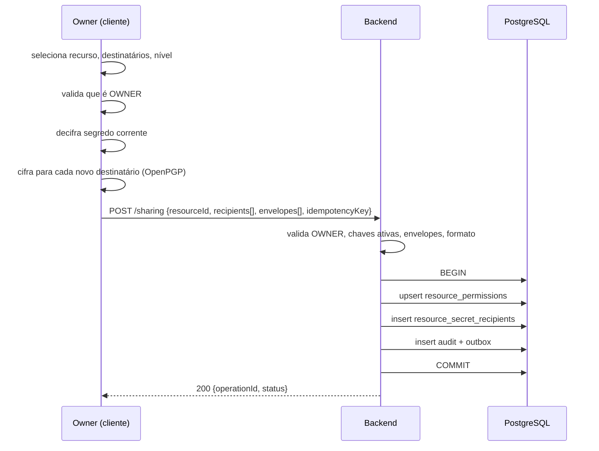
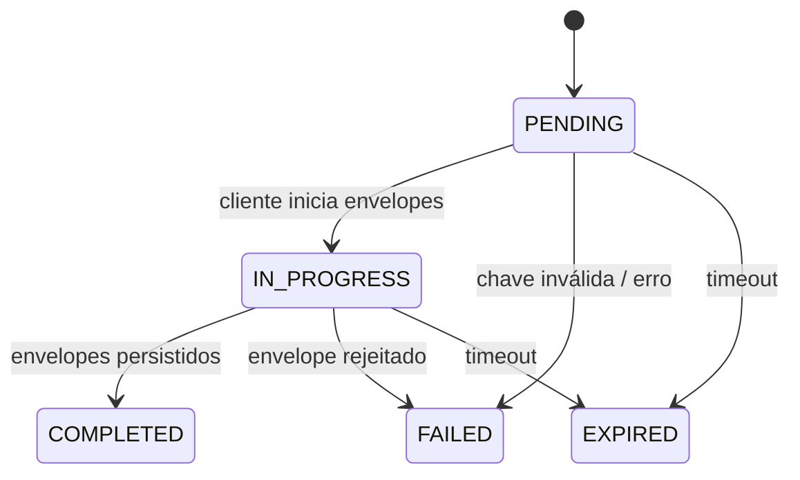

# Domínio — Sharing

## 1. Responsabilidade

Orquestrar o compartilhamento seguro: validar autorização, receber envelopes cifrados do cliente, persistir permissões e envelopes em transação, revogar acessos e coordenar rekey de grupos.

O servidor **não** cifra: quem compartilha é o cliente que já possui a chave privada e o conteúdo em claro.

## 2. Tipos de operação

| Tipo | Gatilho | Efeito |
|---|---|---|
| `SHARE` | usuário compartilha recurso/pasta | cria permissões + envelopes |
| `UNSHARE` | remove usuário/grupo | remove permissão + envelopes |
| `UPDATE_PERMISSION` | altera READ↔UPDATE↔OWNER | atualiza permissão; se downgrade, pode revogar envelopes |
| `REKEY` | novo destinatário em recurso existente | cria envelopes para a versão corrente |
| `GROUP_REKEY` | membro adicionado/removido a grupo | cria/remove envelopes em lote |

## 3. Fluxo de compartilhamento



## 4. Regras de negócio

1. Compartilhar exige `OWNER` no ACO.
2. O ator só pode conceder um nível que ele mesmo possui (não pode dar OWNER se for UPDATE).
3. Todo destinatário precisa ter chave pública ativa.
4. O cliente envia um envelope por destinatário; o backend valida estrutura, checksum e fingerprint.
5. Permissão e envelopes são persistidos na **mesma transação**; ou tudo é aplicado, ou nada.
6. A operação é idempotente por `Idempotency-Key` (TTL 24h).
7. Compartilhar com grupo cria a permissão de grupo e materializa envelopes para os membros ativos.
8. Adicionar membro a grupo não concede acesso imediato: o acesso só é efetivo após o `GROUP_REKEY` concluído.
9. Remover membro de grupo:
   - remove a associação;
   - remove envelopes do usuário nos recursos em que o acesso vinha **somente** daquele grupo;
   - preserva envelopes de permissões diretas e de outros grupos;
   - remove a capacidade de obter versões futuras.
10. Remover a permissão de um usuário remove seus envelopes da versão corrente e impede novas versões.
11. Nenhuma operação pode deixar o recurso sem OWNER.
12. Alteração de permissão para downgrade (OWNER→UPDATE, UPDATE→READ):
    - se o usuário mantém `READ`, ele continua recebendo envelopes das novas versões;
    - se perde `READ`, seus envelopes da versão corrente são removidos e ele não recebe versões futuras.
13. A edição de segredo lista todos os destinatários que receberão a nova versão; o cliente exige confirmação.
14. Toda operação sensível pode exigir step-up (MFA recente).
15. Toda operação é auditada com ator, ACO, ARO, nível, contagem de envelopes e `request_id` — sem ciphertext.
16. Operações que dependem de cliente online (rekey) ficam `PENDING` até a confirmação; o servidor nunca as conclui sozinho.

## 5. Invariantes

- Nenhum envelope sem permissão correspondente.
- Nenhuma permissão sem envelope para usuários com READ+.
- Nenhum recurso sem OWNER.
- Nenhum grupo sem MANAGER.
- Nenhum ciphertext em log/auditoria.
- Nenhuma operação parcialmente aplicada.

## 6. Estados da operação



- `PENDING`: aguardando cliente.
- `IN_PROGRESS`: envelopes sendo enviados.
- `COMPLETED`: permissões + envelopes aplicados.
- `FAILED`: erro recuperável? Não; requer nova operação.
- `EXPIRED`: TTL expirado (default 24h).

## 7. API

| Método | Rota | Permissão | Observação |
|---|---|---|---|
| POST | `/sharing` | OWNER no ACO | cria operação de share/rekey |
| POST | `/sharing/revoke` | OWNER no ACO | remove permissão/envelopes |
| POST | `/sharing/rekey/:operationId/complete` | ator da operação | envia envelopes em lote |
| GET | `/sharing/operations/:id` | ator/admin | status |
| GET | `/sharing/pending` | autenticado | operações que exigem ação do usuário |

## 8. Contratos

```ts
interface SharingService {
  share(input: ShareInput): Promise<SharingOperation>;
  revoke(input: RevokeInput): Promise<SharingOperation>;
  completeRekey(operationId: string, items: RekeyItem[]): Promise<SharingOperation>;
  getOperation(operationId: string): Promise<SharingOperationView>;
  listPending(userId: string): Promise<SharingOperationView[]>;
}
```

## 9. Cenários de borda

| Cenário | Comportamento |
|---|---|
| Destinatário sem chave | 422, operação não inicia |
| Envelope de outro destinatário | 422, transação revertida |
| Último OWNER removido | 409 |
| Grupo sem membros | permissão de grupo criada; nenhum envelope |
| Membro adicionado sem rekey | acesso PENDING; não recebe segredo |
| Cliente offline | operação expira; notifica managers |
| Dois compartilhamentos concorrentes | idempotência + transação; um vence |
| Downgrade UPDATE→READ | mantém envelopes (READ ainda acessa) |
| Revogação READ | remove envelopes da versão corrente |
| Recurso em lixeira | bloqueia compartilhamento |
| Usuário suspenso como destinatário | 422 |

## 10. Testes obrigatórios

- Share para usuário, grupo, múltiplos destinatários.
- Negação sem OWNER.
- Ator não pode conceder nível acima do seu.
- Envelope inválido/quem não é destinatário.
- Idempotência.
- Transação atômica (falha no envelope não cria permissão).
- Remoção de permissão e revogação de envelopes.
- Grupo: add/remove com rekey completo, pendente e expirado.
- Permissão efetiva após operações.
- Step-up.
- Auditoria sem ciphertext.
- Concorrência.

## 11. Fora de escopo

- Cifra/decifra.
- Compartilhamento externo.
- Links públicos.
- Re-criptografia automática pelo servidor.
- Aprovação de acesso por workflow.