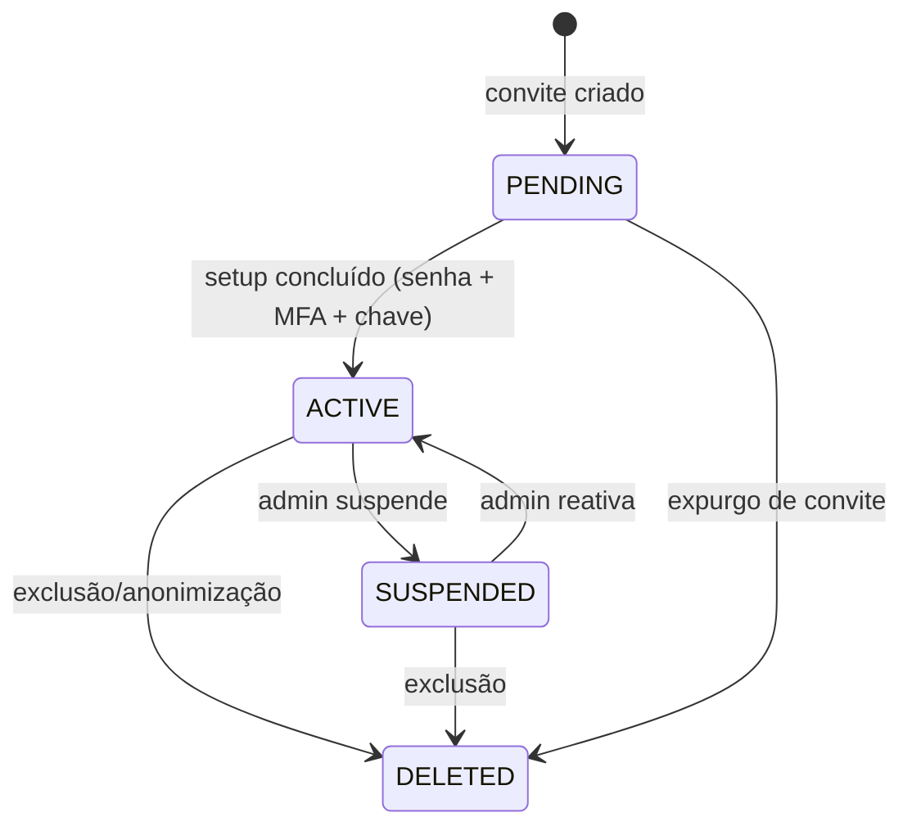

# Domínio — Users

## 1. Responsabilidade

Gerenciar identidade, perfil, status, associação de chaves públicas e ciclo de vida administrativo dos usuários.

## 2. Ciclo de vida



## 3. Regras de negócio

1. O e-mail é o identificador de login, normalizado em lowercase e único.
2. Usuários só podem ser criados por convite administrativo ou por auto-registro se a organização permitir.
3. O convite contém um token de uso único com TTL de 7 dias.
4. A conta permanece `PENDING` até que senha, MFA e chave pública sejam configurados.
5. Um usuário `PENDING` não recebe segredos, não aparece em sugestões de compartilhamento e não pode logar.
6. A ativação exige:
   - senha válida (política de tamanho/entropia);
   - confirmação de e-mail;
   - geração/publicação de chave pública;
   - MFA configurado se exigido pela organização.
7. O perfil contém nome de exibição, avatar, locale, timezone e preferências não sensíveis.
8. Um usuário pode ter múltiplas chaves públicas; exatamente uma é primária e ativa.
9. Chaves expiradas ou revogadas não podem ser usadas como destinatário.
10. A troca de chave primária exige confirmação e revoga a antiga após a janela de re-cifra.
11. A suspensão de um usuário:
    - revoga todas as sessões;
    - impede login;
    - mantém os dados e envelopes existentes;
    - não torna o usuário participante de rekey (gestores assumem).
12. A exclusão é soft delete (90 dias), seguida de anonimização de dados pessoais e revogação de acesso.
13. Nunca armazenar a chave privada em claro; o escrow é opt-in e cifrado pelo cliente.
14. A associação de chave valida armor, fingerprint, UID, expiração e ausência de material privado (ver `domains/cryptography.md`).
15. E-mails de convite/ativação contêm token, nunca senha ou chave.
16. Ações administrativas são auditadas com ator, alvo e motivo.

## 4. Invariantes

- E-mail único e normalizado.
- Toda conta ativa possui ao menos uma chave pública ativa.
- Toda conta ativa possui ao menos um método de MFA se a organização exigir.
- Nenhum usuário ativo pode ser excluído sem transferência/revogação de propriedade (recursos exigem novo OWNER).
- Nenhum dado pessoal em log.

## 5. Eventos

| Evento | Payload |
|---|---|
| `user.invited.v1` | `userId`, `invitedBy`, `expiresAt` |
| `user.registered.v1` | `userId`, `email`, `source` |
| `user.activated.v1` | `userId`, `methods` |
| `user.suspended.v1` | `userId`, `reason`, `actorId` |
| `user.reactivated.v1` | `userId`, `actorId` |
| `user.deleted.v1` | `userId`, `actorId` |
| `user.key.added.v1` | `userId`, `fingerprint` |
| `user.key.revoked.v1` | `userId`, `fingerprint` |
| `user.profile.updated.v1` | `userId`, `fields[]` |

## 6. Contratos

```ts
interface UsersPublicService {
  getActiveUser(userId: string): Promise<User>;
  listActiveUsersByIds(ids: string[]): Promise<User[]>;
  assertActiveUser(userId: string): Promise<void>;
  updateProfile(userId: string, input: UpdateProfileInput): Promise<UserProfile>;
}
```

## 7. Cenários de borda

| Cenário | Comportamento |
|---|---|
| Convite expirado | Rejeita; admin reenvia |
| E-mail já cadastrado | Não revela; envia e-mail genérico |
| Usuário sem chave | Não pode receber segredo; bloqueado em share |
| Chave expirada | Substituir antes de compartilhar |
| Exclusão com recursos | Exige transferência de OWNER ou revogação; nunca orfanar |
| Domínio de e-mail não permitido | Rejeita no convite |
| Usuário suspenso em grupo | Mantém histórico, perde acesso futuro; rekey pendente |

## 8. Testes obrigatórios

- Convite, expiração e reenvio.
- Ativação completa e incompleta.
- E-mail normalizado/duplicado.
- Associação/revogação de chave.
- Suspensão revoga sessões.
- Exclusão não orfana recursos.
- Autorização administrativa (somente ADMIN).
- Auditoria sem dados pessoais sensíveis.

## 9. Fora de escopo

- Perfis públicos entre organizações.
- SSO/SAML (extensão).
- Aprovação de recuperação de conta por admin (roadmap).